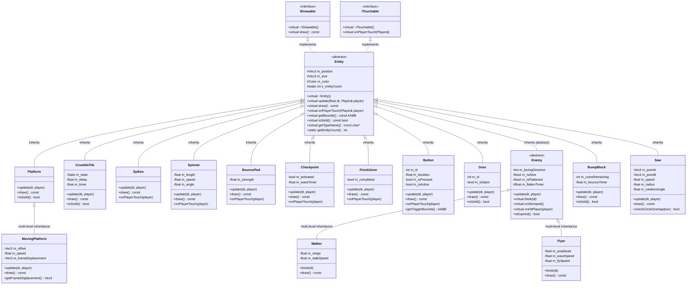
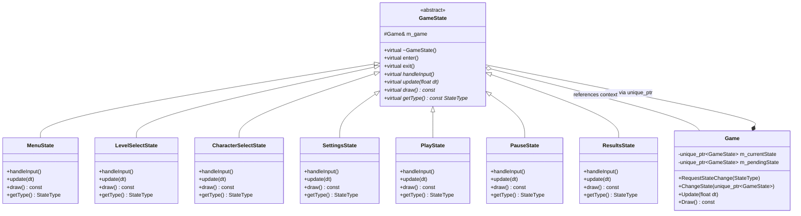
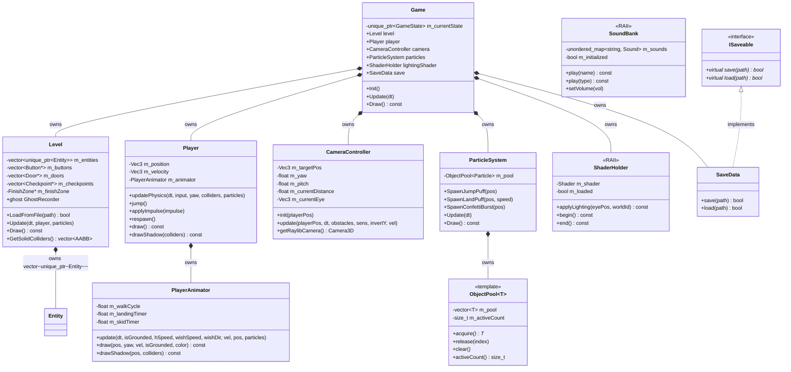

# Object-Oriented Programming (OOP) Architecture & Viva Defense Guide

**Project:** Blocky Obby Adventure (3D Roblox-Style Single-Player Platformer)  
**Language:** C++17  
**Build System:** CMake 3.20+ (raylib 5.5)  

---

## 1. Overview of OOP Architecture

The codebase has been refactored from a procedural, struct-based codebase into a strictly encapsulated, polymorphic object-oriented architecture. The game's 120 Hz fixed-timestep physics, player controls, third-person orbit camera, 20 levels, puzzles, visual shaders, and save data behave 100% identically, while demonstrating the core tenets of modern Object-Oriented Software Engineering:

- **Entity Component Polymorphism:** An abstract base class `Entity` implements pure interfaces `IDrawable` and `ITouchable` (multiple interface inheritance). 10 distinct entities derive from `Entity`, including `MovingPlatform` which demonstrates multi-level inheritance (`MovingPlatform` $\rightarrow$ `Platform` $\rightarrow$ `Entity`).
- **Polymorphic Level Ownership:** `Level` owns entities through `std::vector<std::unique_ptr<Entity>>`. Updating and drawing occur purely via base-class virtual dispatch without `switch` statements or downcasting.
- **Factory Pattern & Exception Handling:** `EntityFactory` dynamically instantiates entities from `.lvl` files, throwing custom `LevelParseError` exceptions upon encountering corrupted data.
- **State Pattern:** Application flow is decoupled into an abstract `GameState` hierarchy (`MenuState`, `PlayState`, `PauseState`, `ResultsState`, `LevelSelectState`, `SettingsState`, `CharacterSelectState`) owned by `Game` via `std::unique_ptr<GameState>`.
- **Encapsulated Value Classes & Operator Overloading:** `Vec3` and `AABB` encapsulate spatial coordinates and geometry, exposing overloaded arithmetic and relational operators.
- **RAII & Resource Management:** `ShaderHolder` and `SoundBank` encapsulate raylib OpenGL and audio resources respectively, managing acquisition in constructors and deallocation in destructors.
- **Generic Class Templates:** A reusable template `ObjectPool<T>` manages particle lifecycle with $O(1)$ swap-and-pop reclamation, eliminating runtime heap allocations.
- **Encapsulation & Namespaces:** All classes have private/protected data members with public accessors and mutators, residing within `namespace obby`.

---

## 2. Comprehensive OOP Concept Mapping Table

| OOP Concept | File(s) / Class | Code Location | Viva Defense Explanation (Why & How) |
|---|---|---|---|
| **Encapsulation** | `src/player.h`, `src/player.cpp` (`Player`) | `Player` class members private | All internal physics variables (`m_position`, `m_velocity`, `m_coyoteTimer`, `m_jumpBufferTimer`) are private. Public methods (`updatePhysics()`, `jump()`, `applyImpulse()`, `getPosition()`, `setPosition()`) expose controlled access, preventing external code from mutating player physics invariants directly. |
| **Abstraction** | `src/game_state.h`, `src/entity.h` | `GameState`, `Entity` | High-level systems only interact with abstract concepts ("update the entity", "render the state") without knowing underlying implementation details like button countdown timers or menu panel layouts. |
| **Inheritance** | `src/spikes.h/.cpp`, `src/button.h/.cpp`, `src/door.h/.cpp` | Derived from `Entity` | Common entity attributes (`m_position`, `m_size`, `m_color`) and default spatial queries (`getBounds()`, `isSolid()`) are defined once in `Entity` and inherited by derived classes, preventing code duplication. |
| **Multi-Level Inheritance** | `src/moving_platform.h`, `src/moving_platform.cpp` (`MovingPlatform`) | `MovingPlatform : public Platform` | `MovingPlatform` inherits from `Platform`, which itself inherits from `Entity`. It reuses static platform geometry and Cap rendering, while adding temporal position oscillation and frame displacement calculation. |
| **Multiple Interface Inheritance** | `src/entity.h` (`Entity`), `src/drawable.h`, `src/touchable.h` | `class Entity : public IDrawable, public ITouchable` | `Entity` simultaneously fulfills two distinct behavioral contracts: `IDrawable` (rendering via `draw() const`) and `ITouchable` (reacting to player collisions via `onPlayerTouch()`), proving C++'s capability for multiple interface realization without diamond problem conflicts. |
| **Polymorphism (Virtual Dispatch)** | `src/level.cpp` (`Level::Update`, `Level::Draw`) | `Level::Update()` & `Level::Draw()` | Entities are stored as base pointers `std::unique_ptr<Entity>`. The runtime invokes the correct derived implementation (`entity->update(dt, player)` and `entity->draw()`) through the virtual method table (vtable) with zero downcasting or type checking. |
| **Pure Virtual Functions & Abstract Classes** | `src/entity.h` (`Entity`), `src/game_state.h` (`GameState`) | `= 0` virtual declarations | `virtual void update(float, Player&) = 0;` and `virtual void draw() const = 0;` in `Entity` ensure that abstract base classes cannot be instantiated on their own, guaranteeing that every concrete entity implements its own update and rendering. |
| **Operator Overloading** | `src/vec3.h`, `src/vec3.cpp`, `src/aabb.h`, `src/aabb.cpp` | `operator+`, `-`, `*`, `/`, `+=`, `-=`, `==`, `!=`, unary `-` | Overloading arithmetic operators on `Vec3` allows mathematical vectors to be added and scaled with natural algebraic syntax (`pos += vel * dt`) rather than cumbersome function calls (`Vector3Add(pos, Vector3Scale(vel, dt))`), significantly improving code readability and mathematical safety. |
| **Member Initializer Lists** | `src/button.cpp`, `src/moving_platform.cpp`, `src/player.cpp` | Constructors | Constructors initialize sub-objects and member variables directly in their initializer lists before the constructor body executes (e.g., `MovingPlatform::MovingPlatform(...) : Platform(...), m_offset(...)`), optimizing construction and preventing redundant default-construction followed by assignment. |
| **Virtual Destructors** | `src/entity.h`, `src/game_state.h`, `src/drawable.h`, `src/saveable.h` | `virtual ~Entity() = default;` | Declaring virtual destructors on all base and interface classes ensures that when derived objects are destroyed through base pointers (`std::unique_ptr<Entity>`), the complete derived destructor chain executes correctly, preventing resource leaks and undefined behavior. |
| **RAII (Resource Acquisition Is Initialization)** | `src/shader_holder.h/.cpp`, `src/sound_bank.h/.cpp` | `ShaderHolder`, `SoundBank` | Encapsulates GPU shaders and audio device handles. Shaders and wave buffers are allocated in constructors (`LoadShader`, `LoadSoundFromWave`) and guaranteed to be deallocated in destructors (`UnloadShader`, `UnloadSound`, `CloseAudioDevice`), eliminating manual cleanup leaks even if exceptions occur. |
| **Class Templates** | `src/object_pool.h` (`ObjectPool<T>`) | `template <typename T> class ObjectPool` | Generic, type-safe object pooling class template managing dynamic capacity expansion and $O(1)$ swap-and-pop reclamation. Reused by `ParticleSystem` to eliminate dynamic heap allocation (`new`/`delete` or `push_back`) in the 120 Hz gameplay loop. |
| **Exception Handling** | `src/level_error.h`, `src/entity_factory.cpp`, `src/level.cpp` | `LevelParseError : public std::runtime_error` | Thrown when `.lvl` data contains corrupted or missing tokens (e.g., invalid float coordinates or unknown entity types). Caught in `Level::LoadFromFile` to log diagnostic line numbers and gracefully recover without crashing the process. |
| **Static Members** | `src/entity.h/.cpp`, `src/entity_factory.h/.cpp` | `Entity::s_entityCount`, `EntityFactory::createEntity` | `Entity::s_entityCount` tracks active heap entity allocations across constructors and destructors. `EntityFactory::createEntity` provides a global factory method to construct derived entities from text tokens without requiring an instance of the factory. |
| **Interfaces** | `src/drawable.h`, `src/touchable.h`, `src/saveable.h` | `IDrawable`, `ITouchable`, `ISaveable` | Pure abstract classes containing only pure virtual methods and a virtual destructor, establishing strict behavioral contracts for rendering, player interaction, and file serialization. |
| **Namespaces** | `src/vec3.h`, `src/entity.h`, `src/game.h`, `src/level.h` | `namespace obby` | Encapsulates all game engine systems within `namespace obby`, preventing naming collisions with global raylib C structs (`Vector3`, `Shader`, `Camera3D`) or third-party libraries. |
| **STL Container Utilization** | `src/level.h`, `src/sound_bank.h`, `src/game.h` | `vector`, `unique_ptr`, `unordered_map` | Leverages modern standard library containers: `std::vector<std::unique_ptr<Entity>>` for polymorphic ownership, `std::unordered_map<std::string, Sound>` in `SoundBank` for $O(1)$ procedural audio lookup, and `std::unique_ptr<GameState>` for exclusive state ownership. |
| **Abstract Sub-Hierarchies** | `src/enemy.h/.cpp`, `src/walker.h/.cpp`, `src/flyer.h/.cpp` | `Enemy`, `Walker`, `Flyer` | `Enemy` introduces an intermediate abstract class between `Entity` and concrete enemies. It encapsulates shared state (`m_facingDirection`, `m_isAlive`, `m_flattenTimer`) and template method stomp arbitration, letting derived classes focus strictly on `think()` movement. |
| **Safe Lifecycle Idiom (Erase-Remove)** | `src/level.cpp`, `src/entity.h` | `Level::Update()` `std::remove_if` | Inactive entities are marked `isExpired() == true` during `update()` and safely pruned afterward via `std::remove_if`. This prevents vector reallocation and iterator invalidation during iteration while letting defeat animations play to completion. |
| **Separation of Physics & Render Geometry** | `src/bump_block.h/.cpp` | `BumpBlock::getBounds()` vs `draw()` | `BumpBlock` maintains a static, resting AABB for solid player collision while procedurally offsetting its drawn model during bounce animation, guaranteeing collision stability without altering spatial physics grids. |
| **Parametric Kinematics & Spatial Overlap** | `src/saw.h/.cpp` | `Saw::update()`, `checkCircleOverlap()` | Evaluates continuous linear interpolation along segment $AB$ and tests circular blades against bounding boxes by clamping the circle center to box extents, avoiding heavy physics engines while maintaining fair, responsive hitboxes. |

---

## 3. Mermaid UML Class Diagrams

### A. Entity & Interface Inheritance Hierarchy

---

### B. Game State Pattern Hierarchy

---

### C. System Architecture & Component Ownership

---

## 4. Viva Voce Defense: Questions & Answers

### Q1: Why did you choose to use `std::vector<std::unique_ptr<Entity>>` in `Level` instead of storing value objects or raw pointers?
> **Answer:**  
> Storing value objects (`std::vector<Entity>`) is impossible because `Entity` is an abstract base class with pure virtual functions and would cause object slicing. Raw pointers (`Entity*`) require manual memory management and expose risk of memory leaks. `std::unique_ptr<Entity>` clearly expresses **exclusive ownership**: the `Level` is solely responsible for entity lifetimes, automatically invokes derived destructors polymorphically via `virtual ~Entity()`, and ensures zero memory leaks when levels are reloaded or the game terminates.

### Q2: What is the purpose of the State Pattern in `Game`, and how does it prevent tight coupling?
> **Answer:**  
> In procedural code, state machines are often implemented as monolithic `switch (state)` statements in `Update()` and `Draw()`, creating a "god class" that couples all screens together. By abstracting states into polymorphic `GameState` subclasses (`MenuState`, `PlayState`, etc.), each screen owns its input handling, update loop, and visual layout. Furthermore, states transition via deferred requests (`m_game.RequestStateChange(StateType)`), ensuring that individual states never include each other's headers or internal variables.

### Q3: How does `MovingPlatform` demonstrate multi-level inheritance, and what functionality is added at each level?
> **Answer:**  
> `MovingPlatform` inherits from `Platform`, which in turn inherits from abstract `Entity` (`MovingPlatform` $\rightarrow$ `Platform` $\rightarrow$ `Entity`).  
> 1. `Entity` provides abstract interface requirements (`update`, `draw`, `getBounds`, `isSolid`) and spatial attributes (`m_position`, `m_size`, `m_color`).  
> 2. `Platform` provides solid AABB collision behavior and decorative top surface caps.  
> 3. `MovingPlatform` adds temporal offset interpolation, oscillating movement between two endpoints, and calculates frame displacement to transport standing players.

### Q4: How does RAII work in `ShaderHolder` and `SoundBank`? What bug would occur without it?
> **Answer:**  
> RAII (Resource Acquisition Is Initialization) ties the lifecycle of unmanaged external resources (OpenGL shader programs and audio device handles) to the lifetime of stack or heap C++ objects. In `ShaderHolder`, the constructor calls `LoadShader()` and caches uniform locations, while the destructor automatically calls `UnloadShader()`. Without RAII, if an exception occurred during level loading or if the game window was closed prematurely, the unmanaged GPU memory or audio device would remain leaked in the host environment.

### Q5: Why did you implement an `ObjectPool<T>` template instead of calling `std::vector::push_back` and `erase` on particles?
> **Answer:**  
> Particle effects (e.g., confetti bursts with 60 particles, jump puffs) spawn and die at 120 Hz. Calling `push_back()` and `erase()` repeatedly triggers dynamic heap allocations (`malloc`/`free`) and $O(N)$ memory copies when deleting elements, causing CPU frame spikes and memory fragmentation. `ObjectPool<T>` pre-allocates a contiguous vector and uses an $O(1)$ swap-and-pop technique (`release()`), providing optimal cache locality and zero runtime memory allocations.

### Q6: What is the purpose of custom exception `LevelParseError`?
> **Answer:**  
> In procedural parsing, invalid files typically return a silent `false`, making it impossible to determine whether a line was corrupted, missing coordinates, or contained an unknown entity token. `LevelParseError` inherits from `std::runtime_error` and carries human-readable error messages specifying the exact line and parsing issue. It allows `EntityFactory` and `Level` to throw on corrupted data and catch at the file loader level to log detailed diagnostics and recover safely.

### Q7: Where is Multiple Interface Inheritance used, and does it cause the Diamond Problem?
> **Answer:**  
> `Entity` implements both `IDrawable` (`draw() const = 0`) and `ITouchable` (`onPlayerTouch(Player&) = 0`). Because both `IDrawable` and `ITouchable` are pure interfaces (containing only pure virtual functions and no data members), there is no shared ancestor state. Hence, it achieves multiple interface implementation cleanly without the Diamond Problem or virtual inheritance overhead.

### Q8: Why did you create an abstract `Enemy` base class instead of deriving `Walker` and `Flyer` directly from `Entity`?
> **Answer:**  
> Grouping common enemy mechanics (facing direction, alive state, flatten animation timer, and stomp vs damage arbitration) into an abstract `Enemy` base class avoids duplicating collision and defeat logic across enemy variants. Derived classes like `Walker` and `Flyer` only need to override `think(dt)` to implement their unique ground or aerial movement patterns. In the game loop, `Level::Update()` updates all enemies polymorphically through base `Entity` pointers without needing type switches or `dynamic_cast`.

### Q9: How does `BumpBlock` maintain collision stability during its bounce animation?
> **Answer:**  
> `BumpBlock` cleanly separates physical collision geometry from visual rendering offset. Its overridden `getBounds()` method always returns the static resting AABB, preventing the player or physics solver from penetrating or shifting through the block. The procedural upward bounce offset (~0.2 m over 0.15 s) is applied strictly during `draw()`, preserving solid collision invariants while delivering a dynamic visual reaction.

### Q10: How does `Saw` handle movement, rotation, and player collision?
> **Answer:**  
> `Saw` inherits from `Entity` as a non-solid hazard and interpolates parametrically along a linear track segment between two endpoints at constant speed. It continuously rotates its triangular blade teeth and tests contact against the player using a circle-vs-AABB distance test (clamping the saw center to the player's bounding box). This approach avoids heavy physics engines while providing a responsive, fair circular hitbox that accurately reflects the spinning blade model.

### Q11: What is the safe-removal idiom (`std::remove_if`), and why is it necessary in `Level::Update()`?
> **Answer:**  
> Erasing elements directly from an `std::vector` while iterating over it invalidates iterators, leading to undefined behavior or skipped entities. To avoid this, defeated enemies set a flatten timer, and once the 0.2 s animation completes, `isExpired()` returns `true`. At the end of the update tick, `Level::Update()` safely reclaims inactive entities in a single cache-friendly $O(N)$ pass using the standard erase-remove idiom (`m_entities.erase(std::remove_if(...), m_entities.end())`).
