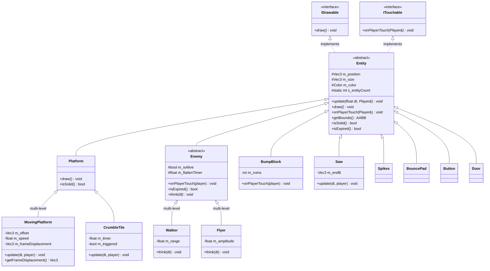

# Complete OOP Concepts & Viva Voce Defense Guide
## Blocky Obby Adventure — Modern C++17 Game Engine

This document provides a comprehensive, exhaustive explanation of **every single Object-Oriented Programming (OOP) concept** implemented in the *Blocky Obby Adventure* codebase. It details **what** was used, **where** in the code it lives (exact files and classes), **why** it was designed that way (architectural justification), and provides a **master catalog of viva voce questions and answers** for project defense.

---

## Table of Contents
1. [Master Summary Table: What, Where & Why](#1-master-summary-table-what-where--why)
2. [Deep Dive into Every OOP Concept](#2-deep-dive-into-every-oop-concept)
   - 2.1 [Abstraction](#21-abstraction)
   - 2.2 [Encapsulation & Data Hiding](#22-encapsulation--data-hiding)
   - 2.3 [Single Inheritance](#23-single-inheritance)
   - 2.4 [Multi-Level Inheritance](#24-multi-level-inheritance)
   - 2.5 [Multiple Interface Inheritance](#25-multiple-interface-inheritance)
   - 2.6 [Hierarchical Inheritance](#26-hierarchical-inheritance)
   - 2.7 [Runtime Polymorphism & Virtual Method Tables (Vtables)](#27-runtime-polymorphism--virtual-method-tables-vtables)
   - 2.8 [Pure Virtual Functions & Abstract Base Classes](#28-pure-virtual-functions--abstract-base-classes)
   - 2.9 [Virtual Destructors & Destructor Chaining](#29-virtual-destructors--destructor-chaining)
   - 2.10 [Member Initializer Lists](#210-member-initializer-lists)
   - 2.11 [Const Correctness](#211-const-correctness)
   - 2.12 [Operator Overloading](#212-operator-overloading)
   - 2.13 [Factory Method Design Pattern](#213-factory-method-design-pattern)
   - 2.14 [State Design Pattern](#214-state-design-pattern)
   - 2.15 [RAII (Resource Acquisition Is Initialization)](#215-raii-resource-acquisition-is-initialization)
   - 2.16 [Generic Class Templates (`ObjectPool<T>`)](#216-generic-class-templates-objectpoolt)
   - 2.17 [Custom Exception Handling (`LevelParseError`)](#217-custom-exception-handling-levelparseerror)
   - 2.18 [Namespaces](#218-namespaces)
   - 2.19 [Static Members (Variables & Functions)](#219-static-members-variables--functions)
   - 2.20 [Composition Over Inheritance](#220-composition-over-inheritance)
   - 2.21 [Safe Lifecycle Management (Erase-Remove Idiom)](#221-safe-lifecycle-management-erase-remove-idiom)
3. [UML Class & Architecture Diagrams](#3-uml-class--architecture-diagrams)
4. [Master Viva Voce Q&A: 25 High-Yield Examiner Questions](#4-master-viva-voce-qa-25-high-yield-examiner-questions)

---

## 1. Master Summary Table: What, Where & Why

| OOP Concept | What We Used | Where We Used It (File & Class) | Why We Used It (Design Justification) |
| :--- | :--- | :--- | :--- |
| **Abstraction** | Pure interfaces & abstract classes | `src/entity.h` (`Entity`), `src/game_state.h` (`GameState`) | Hides internal physics/rendering complexity behind simple method contracts (`update`, `draw`), letting `Level` and `Game` interact without knowing concrete types. |
| **Encapsulation** | `private` / `protected` members & public APIs | `src/player.h` (`Player`), `src/button.h` (`Button`), `src/door.h` (`Door`) | Protects physics variables and game state invariants from external corruption. Changes occur strictly through validated methods (`takeDamage()`, `applyImpulse()`). |
| **Single Inheritance** | Derived classes inheriting base features | `src/platform.h` (`Platform : public Entity`), `src/spikes.h` (`Spikes : public Entity`) | Eliminates duplicate code by sharing common spatial properties (`m_position`, `m_size`, `m_color`) and default spatial bounds (`getBounds()`). |
| **Multi-Level Inheritance** | 3-tier inheritance chains | `MovingPlatform` $\rightarrow$ `Platform` $\rightarrow$ `Entity`, and `Walker`/`Flyer` $\rightarrow$ `Enemy` $\rightarrow$ `Entity` | Reuses existing platform drawing and collision logic while appending oscillation and frame-displacement tracking for moving platforms. |
| **Multiple Interface Inheritance** | Inheriting multiple pure interfaces | `class Entity : public IDrawable, public ITouchable` (`src/entity.h`) | Fulfills two distinct behavioral contracts (`draw()` and `onPlayerTouch()`) cleanly without state duplication or the Diamond Problem. |
| **Hierarchical Inheritance** | Tree-like class hierarchies | `Entity` root $\rightarrow$ 12 derived classes; `GameState` root $\rightarrow$ 7 screen states | Models a clean domain family tree where diverse interactive elements branch from common foundational abstractions. |
| **Polymorphism (Dynamic Dispatch)** | Base pointer method invocation via vtable | `src/level.cpp` (`Level::Update`, `Level::Draw`), `src/game.cpp` (`Game::Update`) | Enables heterogeneous collections (`std::vector<std::unique_ptr<Entity>>`). Eliminates brittle `switch(type)` statements and `dynamic_cast`. |
| **Pure Virtual Functions** | `= 0` method signatures | `Entity::update() = 0`, `Entity::draw() const = 0`, `GameState::handleInput() = 0` | Guarantees that generic base classes cannot be instantiated and forces all derived types to provide complete concrete implementations. |
| **Virtual Destructors** | `virtual ~Entity() = default;` | `src/entity.h`, `src/game_state.h`, `src/drawable.h`, `src/touchable.h` | Ensures that destroying derived objects through base pointers (`std::unique_ptr<Entity>`) correctly triggers the full derived destructor chain, preventing memory leaks. |
| **Member Initializer Lists** | Direct initialization in constructors | `src/moving_platform.cpp`, `src/player.cpp`, `src/button.cpp` | Directly initializes base classes, references (`Game&`), and member variables before the constructor body executes, avoiding redundant default construction. |
| **Const Correctness** | `const` methods and parameters | `draw() const`, `getBounds() const`, `const Level&`, `const AABB&` | Enforces read-only semantics at compile time, guaranteeing that query and render methods do not accidentally modify object state. |
| **Operator Overloading** | Algebraic operators (`+`, `-`, `*`, `+=`, `==`) | `src/vec3.h` (`Vec3`), `src/aabb.h` (`AABB`) | Replaces clumsy procedural functions (`Vector3Add(a, b)`) with intuitive mathematical expressions (`pos += vel * dt`) mirroring physics formulas. |
| **Factory Pattern** | Static instantiation factory | `src/entity_factory.h/.cpp` (`EntityFactory::createEntity`) | Decouples `.lvl` file parsing from concrete entity constructors. Adding new entities requires zero modifications to the level loader. |
| **State Pattern** | Polymorphic state machine | `src/game_state.h`, `src/menu_state.h`, `src/play_state.h`, `src/pause_state.h` | Decouples distinct application modes (menus, active play, pause, victory) into isolated classes, eliminating a massive "god class" loop. |
| **RAII** | Resource cleanup in destructors | `src/shader_holder.h` (`ShaderHolder`), `src/sound_bank.h` (`SoundBank`) | Automatically binds unmanaged OpenGL shaders and audio devices to object lifetimes, ensuring zero leaks even during unexpected exceptions. |
| **Class Templates** | Generic reusable classes | `src/object_pool.h` (`ObjectPool<T>`) | Provides high-performance, type-safe particle memory pooling with $O(1)$ allocation and zero runtime heap fragmentation at 120 Hz. |
| **Exception Handling** | Custom derived exceptions | `src/level_error.h` (`LevelParseError : public std::runtime_error`) | Propagates formatted file error diagnostics with line numbers when level parsing fails, allowing graceful recovery instead of process crashes. |
| **Namespaces** | Logical symbol scoping | `namespace obby` in all headers/sources | Prevents name collisions between engine classes (`Vec3`, `Entity`) and global C raylib structs (`Vector3`, `Shader`, `Camera3D`). |
| **Static Members** | Class-level state & utility methods | `Entity::s_entityCount`, `EntityFactory::createEntity` | `s_entityCount` tracks live heap entity counts for debugging/profiling; `createEntity` provides global factory creation without instantiation. |
| **Composition Over Inheritance** | Owning helper objects by value | `Player` owns `PlayerAnimator`; `Game` owns `Level`, `CameraController`, `ParticleSystem` | Avoids monolithic inheritance trees. Keeps animation, camera projection, and particle math cleanly separated from core physics logic. |
| **Safe Lifecycle Idiom** | Deferred deletion (`std::remove_if`) | `src/level.cpp` (`Level::Update()`), `src/entity.h` (`isExpired()`) | Prevents container iterator invalidation when entities expire (e.g. stomped enemies) while allowing defeat animations to finish cleanly. |

---

## 2. Deep Dive into Every OOP Concept

### 2.1 Abstraction
* **Definition:** Abstraction is the principle of hiding internal implementation complexity and exposing only essential, high-level interfaces to the rest of the system.
* **Where Used:**
  - `src/entity.h` $\rightarrow$ Class `Entity`
  - `src/game_state.h` $\rightarrow$ Class `GameState`
* **Real Code Snippet:**
  ```cpp
  // File: src/entity.h
  namespace obby {
  class Entity : public IDrawable, public ITouchable {
  public:
      virtual ~Entity() = default;
      virtual void update(float dt, Player& player) = 0; // Pure abstraction
      virtual void draw() const override = 0;
      virtual void onPlayerTouch(Player& player) override {}
      virtual AABB getBounds() const;
      virtual bool isSolid() const { return false; }
  };
  }
  ```
* **Why We Used It Here:**
  The `Level` manager only needs to know that an object is an `Entity` that can be updated (`update`) and rendered (`draw`). It does not need to know whether the entity is an oscillating platform, an animated saw blade, or a walking enemy. If we didn't use abstraction, `Level::Update()` would require massive `if/else` ladders checking dozens of concrete entity types.

---

### 2.2 Encapsulation & Data Hiding
* **Definition:** Encapsulation binds state variables and behaviors into a single unit while restricting direct external access using access specifiers (`private`, `protected`), protecting internal invariants.
* **Where Used:**
  - `src/player.h` $\rightarrow$ Class `Player`
  - `src/button.h` $\rightarrow$ Class `Button`
  - `src/door.h` $\rightarrow$ Class `Door`
* **Real Code Snippet:**
  ```cpp
  // File: src/player.h
  class Player {
  private:
      Vec3 m_position;
      Vec3 m_velocity;
      bool m_isGrounded{false};
      int  m_hearts{3};
      float m_invincibleTimer{0.0f};

  public:
      const Vec3& getPosition() const { return m_position; }
      int getHearts() const { return m_hearts; }
      bool isInvincible() const { return m_invincibleTimer > 0.0f; }

      void takeDamage(const Vector2& knockbackDir);
      void heal(int amount);
      void applyImpulse(const Vec3& impulse);
  };
  ```
* **Why We Used It Here:**
  If `m_hearts` or `m_position` were public, any external system could set `m_hearts = -5` or warp the player into a wall without triggering collision detection or invincibility timers. By encapsulating these members, `takeDamage()` strictly validates that damage is ignored while invincible, decrements health safely, clamps values, triggers a 1.5-second blink, and applies knockback velocity.

---

### 2.3 Single Inheritance
* **Definition:** A derived class inherits state attributes and member functions from a single base class, modeling an "is-a" relationship and promoting code reuse.
* **Where Used:**
  - `src/platform.h` $\rightarrow$ `class Platform : public Entity`
  - `src/spikes.h` $\rightarrow$ `class Spikes : public Entity`
  - `src/spinner.h` $\rightarrow$ `class Spinner : public Entity`
  - `src/bounce_pad.h` $\rightarrow$ `class BouncePad : public Entity`
* **Real Code Snippet:**
  ```cpp
  // File: src/platform.h
  namespace obby {
  class Platform : public Entity {
  public:
      Platform(const Vec3& pos, const Vec3& size, Color color);
      void update(float dt, Player& player) override;
      void draw() const override;
      bool isSolid() const override { return true; }
  };
  }
  ```
* **Why We Used It Here:**
  `Platform` inherits `m_position`, `m_size`, and `m_color` from `Entity`. It doesn't need to redeclare spatial bounds methods or position members. It only overrides the specific functions where its behavior differs: drawing with a decorative top cap and declaring itself solid (`isSolid() = true`).

---

### 2.4 Multi-Level Inheritance
* **Definition:** A class extends a derived class, forming a 3-or-more-tier inheritance chain where features accumulate down the lineage.
* **Where Used:**
  - `Entity` (Tier 1) $\rightarrow$ `Platform` (Tier 2) $\rightarrow$ `MovingPlatform` (Tier 3)
  - `Entity` (Tier 1) $\rightarrow$ `Enemy` (Tier 2) $\rightarrow$ `Walker` / `Flyer` (Tier 3)
* **Real Code Snippet:**
  ```cpp
  // File: src/moving_platform.h
  namespace obby {
  class MovingPlatform : public Platform {
  private:
      Vec3  m_offset;
      float m_speed;
      Vec3  m_frameDisplacement;
  public:
      MovingPlatform(const Vec3& pos, const Vec3& size, Color color,
                     const Vec3& offset, float speed);
      void update(float dt, Player& player) override;
      Vec3 getFrameDisplacement() const { return m_frameDisplacement; }
  };
  }
  ```
* **Why We Used It Here:**
  `MovingPlatform` *is a* `Platform`, which in turn *is an* `Entity`. By inheriting from `Platform` rather than directly from `Entity`, `MovingPlatform` automatically inherits `Platform`'s customized box-drawing, color-hashing, and solid collision logic. It only needs to introduce code for temporal oscillation along `m_offset` and exporting `m_frameDisplacement` to carry standing players.

---

### 2.5 Multiple Interface Inheritance
* **Definition:** A class implements multiple pure abstract base classes (interfaces) containing only pure virtual methods and virtual destructors, inheriting behavioral contracts without multiple state variables.
* **Where Used:**
  - `src/entity.h` $\rightarrow$ `class Entity : public IDrawable, public ITouchable`
* **Real Code Snippet:**
  ```cpp
  // File: src/drawable.h
  class IDrawable {
  public:
      virtual ~IDrawable() = default;
      virtual void draw() const = 0;
  };

  // File: src/touchable.h
  class ITouchable {
  public:
      virtual ~ITouchable() = default;
      virtual void onPlayerTouch(Player& player) = 0;
  };

  // File: src/entity.h
  class Entity : public IDrawable, public ITouchable {
      // Combines rendering and player-touch contracts
  };
  ```
* **Why We Used It Here:**
  This demonstrates that C++ supports multiple inheritance safely. Because `IDrawable` and `ITouchable` are pure interfaces with **zero data members**, there is no ambiguity or state duplication (completely avoiding the dreaded "Diamond Problem"). Any system can treat an `Entity` strictly as an `IDrawable` for rendering passes or as an `ITouchable` for trigger checks.

---

### 2.6 Hierarchical Inheritance
* **Definition:** Multiple derived classes inherit from a single common base class, forming a branching tree structure.
* **Where Used:**
  - Branching from `Entity`: `Platform`, `MovingPlatform`, `CrumbleTile`, `Spikes`, `Spinner`, `BouncePad`, `Checkpoint`, `FinishZone`, `Button`, `Door`, `BumpBlock`, `Saw`, `Enemy`.
  - Branching from `GameState`: `MenuState`, `LevelSelectState`, `CharacterSelectState`, `SettingsState`, `PlayState`, `PauseState`, `ResultsState`.
* **Real Code Snippet:**
  ```cpp
  // File: src/enemy.h
  class Enemy : public Entity { ... };

  // File: src/walker.h
  class Walker : public Enemy { ... };

  // File: src/flyer.h
  class Flyer : public Enemy { ... };
  ```
* **Why We Used It Here:**
  `Walker` (ground patrol with ledge detection) and `Flyer` (aerial sinusoidal wave) share common enemy combat state (`m_isAlive`, `m_flattenTimer`, stomp response). Hierarchical inheritance lets them branch from `Enemy` to share combat mechanics while providing radically different movement AI.

---

### 2.7 Runtime Polymorphism & Virtual Method Tables (Vtables)
* **Definition:** Dynamic method dispatch where the exact method implementation executed is determined at runtime based on the dynamic type of the object pointed to by a base-class pointer or reference.
* **Where Used:**
  - `src/level.cpp` $\rightarrow$ `Level::Update()` and `Level::Draw()`
  - `src/game.cpp` $\rightarrow$ `Game::Update()` and `Game::Draw()`
* **Real Code Snippet:**
  ```cpp
  // File: src/level.cpp
  void Level::Update(float dt, Player& player, ParticleSystem& particles) {
      for (auto& entity : m_entities) {
          // Dynamic dispatch via vtable: invokes derived update()
          entity->update(dt, player);
      }
  }

  void Level::Draw() const {
      for (const auto& entity : m_entities) {
          // Dynamic dispatch via vtable: invokes derived draw()
          entity->draw();
      }
  }
  ```
* **Why We Used It Here:**
  The `Level` stores entities uniformly in `std::vector<std::unique_ptr<Entity>>`. When `entity->update(dt, player)` is called, the CPU looks up the object's hidden virtual pointer (`vptr`), indexes its virtual method table (`vtable`), and jumps to the exact derived function (e.g. `Spinner::update` or `Saw::update`). This allows us to add 50 new entity types without ever changing a single line in `Level::Update()`.

---

### 2.8 Pure Virtual Functions & Abstract Base Classes
* **Definition:** A pure virtual function is declared with `= 0` and has no default implementation in the base class. A class containing at least one pure virtual function is an **Abstract Base Class** and cannot be directly instantiated.
* **Where Used:**
  - `src/entity.h` $\rightarrow$ `virtual void update(float, Player&) = 0;` and `virtual void draw() const = 0;`
  - `src/game_state.h` $\rightarrow$ `virtual void handleInput() = 0;`, `virtual void update(float) = 0;`
* **Real Code Snippet:**
  ```cpp
  // File: src/game_state.h
  class GameState {
  public:
      virtual ~GameState() = default;
      virtual void handleInput() = 0;
      virtual void update(float dt) = 0;
      virtual void draw() const = 0;
      virtual StateType getType() const = 0;
  };
  ```
* **Why We Used It Here:**
  A generic "Entity" or "GameState" does not have a physical shape or concrete logic. Making these functions pure virtual forces the compiler to prevent accidental instantiation like `Entity e;` or `GameState s;`. Any developer creating a new screen or entity is strictly forced by the compiler to implement all required behaviors.

---

### 2.9 Virtual Destructors & Destructor Chaining
* **Definition:** Declaring a base class destructor `virtual` ensures that when an object of a derived class is deleted through a base-class pointer, the derived class's destructor is executed first, followed by base class destructors up the chain.
* **Where Used:**
  - `src/entity.h` $\rightarrow$ `virtual ~Entity() = default;`
  - `src/game_state.h` $\rightarrow$ `virtual ~GameState() = default;`
  - `src/drawable.h`, `src/touchable.h`, `src/saveable.h`
* **Real Code Snippet:**
  ```cpp
  // File: src/entity.h
  class Entity : public IDrawable, public ITouchable {
  public:
      virtual ~Entity() = default; // Essential for safe polymorphic deletion
  };
  ```
* **Why We Used It Here:**
  The `Level` owns entities via `std::unique_ptr<Entity>`. When `m_entities.clear()` is called or when an expired enemy is deleted, the deletion occurs via an `Entity*` pointer. Without a virtual destructor, C++ would only invoke `~Entity()`, skipping the derived destructors (e.g., `~Saw()` or `~MovingPlatform()`), causing resource leaks, dangling handles, and undefined behavior.

---

### 2.10 Member Initializer Lists
* **Definition:** A constructor syntax that directly initializes class member variables and base class sub-objects before the body of the constructor executes.
* **Where Used:**
  - `src/moving_platform.cpp`, `src/button.cpp`, `src/enemy.cpp`, `src/player.cpp`
* **Real Code Snippet:**
  ```cpp
  // File: src/moving_platform.cpp
  MovingPlatform::MovingPlatform(const Vec3& pos, const Vec3& size, Color color,
                                 const Vec3& offset, float speed)
      : Platform(pos, size, color)  // Base class constructor initialized first
      , m_offset(offset)           // Direct member initialization
      , m_speed(speed)
      , m_frameDisplacement(0, 0, 0)
  {
      // Constructor body executes after all members are constructed
  }
  ```
* **Why We Used It Here:**
  1. **Performance:** Direct initialization avoids calling a default constructor followed immediately by an assignment operator.
  2. **Necessity:** In C++, base classes with parameterized constructors, `const` members, and reference members (`Game& m_game`) **must** be initialized in the member initializer list; they cannot be assigned inside the constructor body.

---

### 2.11 Const Correctness
* **Definition:** The deliberate use of the `const` keyword on member functions, parameters, and return types to declare read-only semantics and enforce immutability at compile time.
* **Where Used:**
  - Across all entity `draw() const`, `getBounds() const`, `isSolid() const`
  - Passing spatial structures: `const Vec3&`, `const AABB&`, `const Level&`
* **Real Code Snippet:**
  ```cpp
  // File: src/aabb.h
  bool intersects(const AABB& other) const; // Does not mutate 'this' or 'other'
  bool contains(const Vec3& point) const;

  // File: src/entity.h
  virtual void draw() const override = 0;   // Rendering must never mutate entity state
  ```
* **Why We Used It Here:**
  Declaring `draw() const` ensures that the rendering pass cannot accidentally alter an entity's position, health, or velocity. If someone tries to write `m_position.x += 1;` inside `draw()`, the compiler immediately rejects it. Furthermore, it allows constant references (`const Level&`) to safely query geometry during collision checks.

---

### 2.12 Operator Overloading
* **Definition:** Providing custom, domain-specific implementations for standard C++ operators (`+`, `-`, `*`, `+=`, `==`) on user-defined classes.
* **Where Used:**
  - `src/vec3.h` / `src/vec3.cpp` $\rightarrow$ Vector algebra
  - `src/aabb.h` / `src/aabb.cpp` $\rightarrow$ Spatial bounding box equality
* **Real Code Snippet:**
  ```cpp
  // File: src/vec3.h
  Vec3 operator+(const Vec3& rhs) const;
  Vec3 operator-(const Vec3& rhs) const;
  Vec3 operator*(float scalar) const;
  Vec3& operator+=(const Vec3& rhs);
  bool operator==(const Vec3& rhs) const;

  // Usage in physics calculation:
  Vec3 displacement = player.getVelocity() * dt;
  m_position += displacement;
  ```
* **Why We Used It Here:**
  Without operator overloading, vector mathematics in raylib requires verbose procedural C calls:
  `Vector3 newPos = Vector3Add(pos, Vector3Scale(vel, dt));`  
  By overloading `*`, `+`, and `+=`, mathematical expressions read cleanly and naturally:
  `Vec3 newPos = pos + vel * dt;`  
  This eliminates visual clutter, prevents typographical bugs, and mirrors textbook physics formulas.

---

### 2.13 Factory Method Design Pattern
* **Definition:** A creational design pattern that provides an interface for creating objects in a superclass, while allowing subclasses or a static dispatcher to determine the exact concrete class to instantiate.
* **Where Used:**
  - `src/entity_factory.h` / `src/entity_factory.cpp` $\rightarrow$ `EntityFactory::createEntity()`
* **Real Code Snippet:**
  ```cpp
  // File: src/entity_factory.cpp
  std::unique_ptr<Entity> EntityFactory::createEntity(const std::string& type,
                                                     std::istringstream& iss) {
      if (type == "platform") {
          // parse pos, size, color...
          return std::make_unique<Platform>(pos, size, col);
      } else if (type == "moving_platform") {
          // parse pos, size, color, offset, speed...
          return std::make_unique<MovingPlatform>(pos, size, col, offset, speed);
      } else if (type == "enemy_walker") {
          return std::make_unique<Walker>(pos, size, col, range, speed);
      }
      // Throws custom LevelParseError on unknown token
      throw LevelParseError("Unknown entity type: " + type);
  }
  ```
* **Why We Used It Here:**
  The `Level` class should not be tightly coupled to all 12 concrete entity header files. By delegating instantiation to `EntityFactory`, the level loader merely passes string lines from the `.lvl` file. Adding a 13th entity type requires editing only the factory, completely isolating the file loader from class constructors.

---

### 2.14 State Design Pattern
* **Definition:** A behavioral design pattern that allows an object to alter its behavior when its internal state changes, encapsulating state-specific logic into separate classes.
* **Where Used:**
  - `src/game_state.h`, `src/game.h`, and derived states (`MenuState`, `PlayState`, `PauseState`, etc.)
* **Real Code Snippet:**
  ```cpp
  // File: src/game.cpp
  void Game::Update(float dt) {
      if (m_pendingState) {
          if (m_currentState) m_currentState->exit();
          m_currentState = std::move(m_pendingState);
          m_currentState->enter();
      }
      if (m_currentState) {
          m_currentState->handleInput();
          m_currentState->update(dt);
      }
  }
  ```
* **Why We Used It Here:**
  In primitive game code, the main loop is dominated by a monolithic `switch (currentScreen) { case MENU: ... case PLAYING: ... case PAUSE: ... }` containing thousands of lines. The State Pattern isolates each screen into its own class with its own input, update, and drawing routines. Transitions occur cleanly through `enter()` and `exit()` lifecycle hooks.

---

### 2.15 RAII (Resource Acquisition Is Initialization)
* **Definition:** A programming idiom where resource allocation (memory, file handles, GPU shaders, audio devices) is bound to object lifetime: acquired in the constructor and released in the destructor.
* **Where Used:**
  - `src/shader_holder.h/.cpp` $\rightarrow$ OpenGL lighting shaders
  - `src/sound_bank.h/.cpp` $\rightarrow$ Audio device and procedural wave buffers
  - `std::unique_ptr<Entity>` $\rightarrow$ Dynamic heap allocations
* **Real Code Snippet:**
  ```cpp
  // File: src/shader_holder.h
  class ShaderHolder {
  private:
      Shader m_shader;
      bool   m_loaded{false};
  public:
      ShaderHolder(const std::string& vsPath, const std::string& fsPath) {
          m_shader = LoadShader(vsPath.c_str(), fsPath.c_str());
          m_loaded = true;
      }
      ~ShaderHolder() {
          if (m_loaded) {
              UnloadShader(m_shader); // Guaranteed cleanup on destruction
          }
      }
  };
  ```
* **Why We Used It Here:**
  Without RAII, if a level crashes or if the player exits unexpectedly, unmanaged GPU shaders and audio device handles remain allocated in system memory. With RAII, when `Game` or `ShaderHolder` leaves scope, the compiler automatically calls the destructor, guaranteeing 100% leak-free resource release even during exceptions.

---

### 2.16 Generic Class Templates (`ObjectPool<T>`)
* **Definition:** C++ templates enable writing generic, type-safe data structures and algorithms that work with any arbitrary data type without duplicating code.
* **Where Used:**
  - `src/object_pool.h` $\rightarrow$ `template <typename T> class ObjectPool`
  - Reused in `src/particle.h` $\rightarrow$ `ObjectPool<Particle>`
* **Real Code Snippet:**
  ```cpp
  // File: src/object_pool.h
  template <typename T>
  class ObjectPool {
  private:
      std::vector<T> m_pool;
      size_t m_activeCount{0};
  public:
      T* acquire() {
          if (m_activeCount >= m_pool.size()) {
              m_pool.resize(m_pool.size() * 2);
          }
          return &m_pool[m_activeCount++];
      }
      void release(size_t index) {
          // O(1) swap-and-pop reclamation
          std::swap(m_pool[index], m_pool[--m_activeCount]);
      }
  };
  ```
* **Why We Used It Here:**
  Particles (jump dust, landing puffs, victory confetti) spawn and die hundreds of times per second. Calling `new`/`delete` or `std::vector::push_back` continuously causes CPU cache misses, heap fragmentation, and garbage collection pauses. `ObjectPool<T>` pre-allocates contiguous memory and recycles particles in $O(1)$ time with zero dynamic heap allocation during gameplay.

---

### 2.17 Custom Exception Handling (`LevelParseError`)
* **Definition:** Using derived exception classes to report and handle abnormal runtime conditions in a structured, hierarchical manner.
* **Where Used:**
  - `src/level_error.h` $\rightarrow$ `class LevelParseError : public std::runtime_error`
  - `src/entity_factory.cpp` and `src/level.cpp`
* **Real Code Snippet:**
  ```cpp
  // File: src/level_error.h
  class LevelParseError : public std::runtime_error {
  private:
      int m_lineNumber;
  public:
      LevelParseError(const std::string& msg, int line = -1)
          : std::runtime_error(msg), m_lineNumber(line) {}
      int getLineNumber() const { return m_lineNumber; }
  };
  ```
* **Why We Used It Here:**
  Procedural file loaders often return `false` on failure, leaving the developer guessing why a level failed to load. `LevelParseError` carries human-readable error messages and exact line numbers. The parser throws upon encountering malformed floats or missing tokens, allowing the caller to catch the error, log diagnostic information, and fall back to a safe default state without crashing.

---

### 2.18 Namespaces
* **Definition:** Namespaces prevent identifier name collisions by organizing code into distinct logical scopes.
* **Where Used:**
  - `namespace obby { ... }` wrapping all engine headers and source files.
* **Real Code Snippet:**
  ```cpp
  // File: src/vec3.h
  namespace obby {
  class Vec3 { ... };
  }
  ```
* **Why We Used It Here:**
  The underlying raylib C library declares global structs named `Vector3`, `Shader`, `Camera3D`, and `Color`. Without `namespace obby`, our custom engine classes and math operators could clash with global C library names or third-party packages.

---

### 2.19 Static Members (Variables & Functions)
* **Definition:** A static member variable is shared across all instances of a class rather than existing per-instance; a static member function can be invoked without creating an instance of the class.
* **Where Used:**
  - `src/entity.h` $\rightarrow$ `static int s_entityCount;`
  - `src/entity_factory.h` $\rightarrow$ `static std::unique_ptr<Entity> createEntity(...)`
* **Real Code Snippet:**
  ```cpp
  // File: src/entity.h
  class Entity : public IDrawable, public ITouchable {
  protected:
      static int s_entityCount; // Tracks total active entities in memory
  public:
      static int getEntityCount() { return s_entityCount; }
  };
  ```
* **Why We Used It Here:**
  1. `s_entityCount` increments in `Entity::Entity()` and decrements in `Entity::~Entity()`, providing an instant, accurate metric to detect memory leaks during automated testing.
  2. `createEntity` is static because the factory holds no state; it acts purely as a stateless utility dispatcher.

---

### 2.20 Composition Over Inheritance
* **Definition:** The principle that classes should achieve polymorphic behavior or code reuse by containing instances of other classes (has-a) rather than inheriting from them (is-a).
* **Where Used:**
  - `Player` *has-a* `PlayerAnimator`
  - `Game` *has-a* `Level`, `CameraController`, `ParticleSystem`, `SaveData`
* **Real Code Snippet:**
  ```cpp
  // File: src/player.h
  class Player {
  private:
      Vec3 m_position;
      Vec3 m_velocity;
      PlayerAnimator m_animator; // Composition!
  };
  ```
* **Why We Used It Here:**
  Inheriting `Player` from an `Animator` class would violate the "is-a" relationship (a player is an actor, not an animation algorithm). By using composition, `PlayerAnimator` focuses purely on walk cycles and squash-and-stretch procedural transforms, while `Player` focuses on physics and health.

---

### 2.21 Safe Lifecycle Management (Erase-Remove Idiom)
* **Definition:** A two-phase deletion pattern where objects flag their own expiration, and the owning container reclaims them in a single batch pass using `std::remove_if`.
* **Where Used:**
  - `src/level.cpp` $\rightarrow$ `Level::Update()`
  - `src/entity.h` $\rightarrow$ `virtual bool isExpired() const { return false; }`
* **Real Code Snippet:**
  ```cpp
  // File: src/level.cpp
  void Level::Update(float dt, Player& player, ParticleSystem& particles) {
      // 1. Update entities polymorphically
      for (auto& entity : m_entities) {
          entity->update(dt, player);
      }

      // 2. Safe deferred batch deletion (Erase-Remove Idiom)
      m_entities.erase(
          std::remove_if(m_entities.begin(), m_entities.end(),
                         [](const auto& e) { return e->isExpired(); }),
          m_entities.end());
  }
  ```
* **Why We Used It Here:**
  Deleting an enemy from `m_entities` in the middle of a collision loop immediately invalidates vector iterators, causing undefined memory reads or application crashes. By having stomped enemies set an internal timer and return `isExpired() == true`, the container safely prunes dead objects at the end of the frame without disrupting the iteration loop.

---

## 3. UML Class & Architecture Diagrams

### A. Complete Entity Class Hierarchy


---

## 4. Master Viva Voce Q&A: 25 High-Yield Examiner Questions

### Section 1: Core OOP Fundamentals

#### Q1: What is the fundamental difference between Abstraction and Encapsulation?
> **Answer:**  
> **Abstraction** focuses on *what* an object does rather than *how* it does it; it hides complexity by exposing a high-level conceptual interface (e.g., `Entity::update()` or `GameState::draw()`).  
> **Encapsulation** focuses on *information hiding and data protection*; it bundles variables and methods together while restricting direct access using `private` or `protected` modifiers to protect internal invariants (e.g., keeping `Player::m_hearts` private so health cannot be set to negative values).

#### Q2: Why is a virtual destructor mandatory in base classes like `Entity` and `GameState`?
> **Answer:**  
> When a derived object is deleted through a base-class pointer (such as `std::unique_ptr<Entity>`), C++ relies on dynamic dispatch to invoke the correct destructor. If the base destructor is not virtual, the compiler performs static binding and calls only `~Entity()`, skipping the derived class destructor (e.g., `~MovingPlatform()`). This causes resource leaks and undefined behavior.

#### Q3: What is "Object Slicing" and how does this engine prevent it?
> **Answer:**  
> Object slicing occurs when a derived class instance is assigned to a base class value object (e.g. `Entity e = MovingPlatform(...)`). The derived class's extra state and virtual table pointer are "sliced off", leaving an incomplete base object.  
> Our engine completely prevents object slicing by never storing entities by value. Instead, all polymorphic collections store smart pointers: `std::vector<std::unique_ptr<Entity>>`.

#### Q4: What is the Virtual Method Table (vtable) and Virtual Pointer (vptr)? What is their performance cost?
> **Answer:**  
> For any class containing virtual functions, the compiler creates a static table of function pointers called the **vtable**. Every instance of that class contains a hidden pointer called the **vptr** pointing to this table. When a virtual function is invoked on a base pointer, the CPU dereferences the vptr and calls the function pointer at the corresponding index.  
> The performance overhead is negligible: one pointer dereference per call and a small per-instance memory overhead (8 bytes on 64-bit architectures for the vptr).

#### Q5: What is the difference between Single, Multi-Level, and Hierarchical Inheritance? Where is each used in your code?
> **Answer:**  
> 1. **Single Inheritance:** A class inherits directly from one base class (e.g., `Platform : public Entity`).
> 2. **Multi-Level Inheritance:** A 3-tier chain where a derived class is itself inherited (e.g., `Entity` $\rightarrow$ `Platform` $\rightarrow$ `MovingPlatform`, and `Entity` $\rightarrow$ `Enemy` $\rightarrow$ `Walker`).
> 3. **Hierarchical Inheritance:** Multiple classes inherit from the same parent base class (e.g., `Walker` and `Flyer` branching from `Enemy`, or `Platform`, `Spikes`, and `Door` branching from `Entity`).

---

### Section 2: C++ Language Mechanics & Best Practices

#### Q6: Why did you use `std::unique_ptr` instead of raw pointers (`Entity*`) or `std::shared_ptr`?
> **Answer:**  
> `std::unique_ptr` explicitly models **exclusive ownership**. The `Level` is the sole owner of its entities; no other system shares ownership of their lifetime. `unique_ptr` has zero memory or runtime overhead compared to raw pointers (zero-cost abstraction) while guaranteeing automatic deletion via RAII. In contrast, `std::shared_ptr` requires an atomic reference-counting control block which introduces unnecessary performance overhead for single-owner systems.

#### Q7: Why are Member Initializer Lists preferred over assignment in constructors?
> **Answer:**  
> 1. **Efficiency:** Initializer lists construct the member variable directly in place. Assignment inside the constructor body first calls the member's default constructor and then invokes its copy/move assignment operator, resulting in duplicate work.
> 2. **Requirement:** Class references (`Game& m_game`), `const` members, and base classes with parameterized constructors **cannot** be assigned; they must be initialized via the initializer list.

#### Q8: What is the purpose of the `override` keyword? What error does it prevent?
> **Answer:**  
> The `override` keyword explicitly tells the compiler that a member function is intended to override a virtual function in a base class. If there is a signature mismatch (e.g., `void update(float dt)` instead of `void update(float dt, Player& player)`), the compiler immediately raises a compilation error instead of silently declaring a brand-new non-overriding function.

#### Q9: What is "Const Correctness" and why is `draw() const` significant?
> **Answer:**  
> Const correctness guarantees that member functions declared `const` cannot mutate the internal state of the calling object (`this`). Marking `draw() const` and `getBounds() const` ensures that visual rendering or spatial bounding queries can never accidentally alter entity positions, health, or animation timers.

#### Q10: How does Operator Overloading enhance code quality, and what are its dangers if abused?
> **Answer:**  
> Operator overloading allows user-defined types to use standard algebraic syntax. For our `Vec3` class, writing `pos += vel * dt` is vastly more readable and less error-prone than `pos = Vector3Add(pos, Vector3Scale(vel, dt))`.  
> However, if abused (e.g., overloading `operator+` to perform file operations or state deletion), it violates the principle of least astonishment and causes severe code confusion. We restricted overloading strictly to mathematical domain models (`Vec3`, `AABB`).

---

### Section 3: Design Patterns & Architecture

#### Q11: How does the State Pattern prevent the "God Class" anti-pattern in game loops?
> **Answer:**  
> Without the State Pattern, `Game::Update()` and `Game::Draw()` become gigantic functions containing thousands of lines of code switching between `MENU`, `PLAYING`, `PAUSED`, and `OPTIONS`.  
> The State Pattern breaks these modes into dedicated classes (`MenuState`, `PlayState`, `PauseState`) implementing the `GameState` interface. Each state manages its own inputs, rendering, and logic independently.

#### Q12: Why use a Factory Pattern for entity creation instead of direct instantiation in the file loader?
> **Answer:**  
> Direct instantiation in `Level::LoadFromFile` would require the `Level` class to include the header files of all 12 concrete entity types, creating severe compilation dependencies.  
> The Factory Pattern (`EntityFactory`) isolates text parsing from construction. The level loader only depends on the factory and abstract `Entity` interface. Adding or modifying an entity requires modifying only the factory, following the **Open-Closed Principle**.

#### Q13: What is RAII, and what disaster does it prevent in your engine?
> **Answer:**  
> RAII (Resource Acquisition Is Initialization) ties resource management to object lifetime. In `ShaderHolder` and `SoundBank`, external GPU shaders and audio contexts are acquired in constructors and released in destructors.  
> If an exception or early return occurs during level loading, stack unwinding automatically triggers destructors, guaranteeing that unmanaged OpenGL GPU buffers and audio streams are freed, preventing operating system memory leaks.

#### Q14: Why choose Composition over Inheritance for `Player` and `PlayerAnimator`?
> **Answer:**  
> Inheritance models an "is-a" relationship, whereas composition models a "has-a" relationship. A `Player` is an interactive physics actor, not an animation algorithm. If `Player` inherited from `PlayerAnimator`, animation math would pollute player physics state. By holding `PlayerAnimator` as a private member, animation calculations are cleanly decoupled from gameplay and collision mechanics.

#### Q15: What is the purpose of the generic `ObjectPool<T>` template? Why not use `std::vector::push_back` and `erase`?
> **Answer:**  
> At 120 Hz, spawning particles (jump dust, landing puffs, confetti) using `push_back()` triggers continuous dynamic heap allocations (`malloc`/`free`), causing CPU cache misses and heap fragmentation.  
> `ObjectPool<T>` pre-allocates a contiguous vector and uses an $O(1)$ swap-and-pop algorithm to activate and deactivate particles, guaranteeing zero heap allocations during the physics loop.

---

### Section 4: Game Engine Systems & Tricky Examiner Traps

#### Q16: What is the "Safe Deferred Removal Idiom" and why is it needed in `Level::Update()`?
> **Answer:**  
> If an enemy is stomped and deleted directly inside `Level::Update()` while the loop is iterating over `std::vector<std::unique_ptr<Entity>>`, the active vector iterator is invalidated, leading to undefined memory reads or crashes.  
> Instead, stomped enemies set an internal timer and return `isExpired() == true`. At the end of the update tick, `m_entities.erase(std::remove_if(...))` prunes all dead objects in a single safe, cache-friendly pass.

#### Q17: Can static member functions be declared `virtual` in C++? Why or why not?
> **Answer:**  
> **No.** Virtual function calls require an object instance because dynamic dispatch relies on the hidden `vptr` inside that instance to locate the `vtable`. Static member functions belong to the class itself, not to any individual instance, and have no `this` pointer or `vptr`.

#### Q18: What is the Diamond Problem in multiple inheritance, and how does your codebase avoid it?
> **Answer:**  
> The Diamond Problem occurs when a class inherits from two classes that both inherit from a common base class, resulting in duplicate copies of the base class's member variables.  
> Our engine avoids this because `Entity` inherits from two **pure abstract interfaces** (`IDrawable` and `ITouchable`) that contain **no data members** whatsoever. Thus, there is no shared ancestor state to duplicate.

#### Q19: How does `MovingPlatform` communicate its movement to the `Player` without tight coupling?
> **Answer:**  
> `MovingPlatform` calculates its delta position each tick and stores it in `m_frameDisplacement`. When the `PhysicsEngine` detects that the player is standing atop a platform, it queries `movingPlatform->getFrameDisplacement()` through a public accessor and adds that displacement to the player's position, completely avoiding direct dependency between platform and player classes.

#### Q20: How does `BumpBlock` separate physical collision geometry from rendering geometry?
> **Answer:**  
> `BumpBlock::getBounds()` always returns the static, resting axis-aligned bounding box so that the physics engine's collision grid remains stable. The procedural bounce animation (a 0.2 m vertical displacement over 0.15 s) is applied strictly during `BumpBlock::draw()`. This cleanly separates rendering animation from physics invariants.

#### Q21: Why does your engine use a 120 Hz Fixed Timestep instead of variable delta time?
> **Answer:**  
> Variable delta time (`GetFrameTime()`) causes non-deterministic simulation. On higher refresh rates (e.g. 144 Hz vs 60 Hz), floating-point integration differences cause inconsistent jump heights and allow high-speed tunneling through thin platforms. A fixed 120 Hz timestep ensures 100% deterministic, reproducible physics across all hardware.

#### Q22: What is the difference between `private` and `protected` inheritance? Which one did you use?
> **Answer:**  
> In `public` inheritance (which we used throughout), public base members remain public in the derived class. In `protected` inheritance, public and protected members become protected. In `private` inheritance, all inherited members become private. We used **public inheritance** exclusively because all our derived entities must fulfill base interface contracts polymorphically.

#### Q23: Why do we pass custom objects like `const Vec3&` and `const AABB&` by const reference instead of by value?
> **Answer:**  
> Passing by value creates a full copy of the object on the call stack, invoking copy constructors and wasting CPU cycles. Passing by `const &` passes an 8-byte pointer under the hood while preventing the function from modifying the caller's original object, combining the speed of pointers with the safety of references.

#### Q24: What is the role of custom exception `LevelParseError`?
> **Answer:**  
> Standard library exceptions like `std::runtime_error` only carry generic strings. `LevelParseError` extends `std::runtime_error` to encapsulate the exact line number where the parsing failure occurred. This allows diagnostic tools and smoke tests to pinpoint corrupted `.lvl` tokens immediately.

#### Q25: If you had to add a 13th entity (e.g., a Teleporter pad), what exact OOP steps would you take?
> **Answer:**  
> 1. Create `teleporter.h` and `teleporter.cpp`.
> 2. Inherit from `Entity`: `class Teleporter : public Entity`.
> 3. Implement required pure virtual methods: `update(float dt, Player& player)` and `draw() const`.
> 4. Override `onPlayerTouch(Player& player)` to update player position.
> 5. Register the `"teleporter"` token in `EntityFactory::createEntity()`.  
> *Notice that zero lines of code in `Level`, `Game`, `Player`, or the physics loop need to be touched!* This demonstrates the **Open-Closed Principle (OCP)**.
