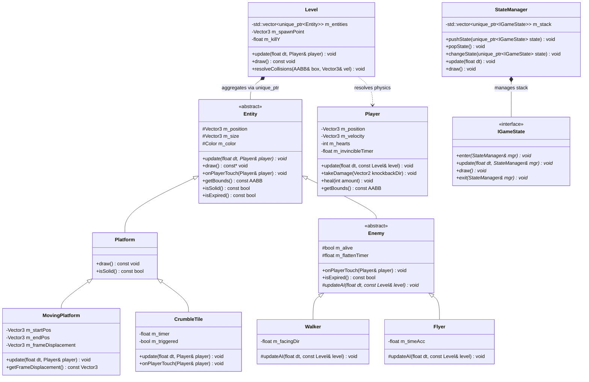

# Project Synopsis
## Blocky Obby Adventure: An Object-Oriented 3D/2D Platformer Game Engine in Modern C++

**Course / Curriculum:** [Course Name / Code, e.g., CS201 - Object-Oriented Programming Lab]  
**Academic Year:** [2025–2026]  
**Branch / Version Described:** `2d-version` (Incorporating 3D Engine Core & 2D Side-Scrolling Gameplay Extensions)  

---

### Student & Institutional Details

- **Student Name:** Gourav Meena
- **Roll Number / Registration ID:** BT25CSE138
- **Degree / Programme:** B.Tech in Computer Science and Engineering
- **Department:**  Computer Science & Engineering
- **Project Supervisor / Guide:** Guide / Instructor Name, Designation
- **Date of Submission:** November 2026

---

### Abstract

*Blocky Obby Adventure* is a cross-platform, real-time 3D and 2D obstacle-course platformer game engine designed and implemented from scratch in Modern C++ (ISO C++17) utilizing the lightweight raylib graphics and audio framework. The project serves as an applied demonstration of core Object-Oriented Programming (OOP) paradigms, clean software architecture, and deterministic real-time simulation without relying on heavy commercial game engines. The architecture implements an abstract entity-component hierarchy, a decoupled finite state machine, a parameterized factory for runtime level parsing, and strict Resource Acquisition Is Initialization (RAII) memory management. Simulation stability is maintained through a 120 Hz fixed-timestep substepping physics engine featuring axis-aligned bounding box (AABB) continuous penetration resolution, coyote timing, jump buffering, moving platform momentum transfer, and dynamic combat interactions (stomping, invincibility frames, and knockback). The codebase includes a comprehensive 16-suite headless automated smoke test framework and an analytical level reachability validator. This synopsis details the system architecture, mathematical formulations, OOP design patterns, and engineering deliverables of the project.

---

### 1. Introduction & Problem Statement

Interactive real-time simulations such as video games represent one of the most demanding domains in software engineering. Historically, educational game projects often devolve into tightly coupled, procedural "spaghetti code" where input handling, collision response, rendering, and gameplay logic reside within monolithic loop structures. Such architectures suffer from severe technical debt, fragile state management, high regression rates, and poor testability.

Conversely, contemporary commercial game engines (e.g., Unreal Engine, Unity) abstract fundamental computer science concepts behind visual script graphs, garbage-collected runtimes, or complex macro-heavy code generation tools. This obscures low-level memory layout, manual dynamic dispatch, cache locality, and numerical simulation mechanics.

The objective of *Blocky Obby Adventure* is to bridge this pedagogical gap. By constructing a custom, lightweight game engine in native C++17:
1. Object-oriented paradigms (deep inheritance, runtime polymorphism, data encapsulation, operator overloading, and factory abstractions) are implemented directly and transparently.
2. The simulation pipeline adheres to modern industry patterns (fixed-timestep accumulation, substepped collision resolution, and decoupled state management).
3. The engine runs natively across Linux, macOS, and Windows while remaining fully verifiable in headless environments (such as Continuous Integration pipelines) through automated unit and integration test harnesses.

---

### 2. Objectives & Scope

#### 2.1 Project Objectives
- **Demonstrate Core OOP Paradigms:** Implement an extensible class hierarchy where game entities, user interface states, and spatial volumes leverage inheritance, virtual method tables (vtables), and encapsulation.
- **Ensure Deterministic Simulation:** Eliminate frame-rate-dependent gameplay discrepancies by decoupling physics computation (fixed at 120 Hz) from variable display refresh rates (VSync / 60–240 Hz).
- **Maintain High Code Quality:** Enforce zero-warning compilation under `-Wall -Wextra -pedantic -Werror` on Clang, GCC, and MSVC compilers.
- **Provide Extensible Level Authoring:** Design a human-readable, tokenized plain-text file format (`.lvl`) supported by an entity factory and analytical level validator.
- **Support Dual Viewports:** Architect the renderer and camera systems to support both orbital third-person 3D gameplay and locked-axis orthographic 2D platforming.

#### 2.2 Project Scope
The project scope encompasses:
- A complete, self-contained single-player obstacle course game across 4 distinct thematic worlds comprising 20 campaign levels, puzzle stages, and dedicated 2D challenge courses.
- Interactive entity mechanics including static platforms, linear moving platforms, crumbling platforms, instant-death hazards (spikes, kill planes), continuous spinners, dynamic bounce pads, checkpoints, doors unlocked via mechanical pressure buttons, coin-yielding bump blocks, linear saw blades, and mobile ground/aerial enemies.
- Persistent player progression tracking (level unlocks, completion times, collectible star ratings, and audio volume levels) saved to structured disk files.
- Automated headless verification tools including a 16-suite unit/integration test runner (`--smoke-test`) and a geometric jump reachability validator (`--validate`).

The project explicitly excludes networking/multiplayer synchronization, external physics engine dependencies (e.g., PhysX, Box2D, Bullet), and proprietary digital asset formats.

---

### 3. System Requirements

#### 3.1 Hardware Requirements
- **Processor:** x86_64 or ARM64 (Apple Silicon / aarch64) dual-core processor clocked at $\ge 2.0\text{ GHz}$.
- **System Memory (RAM):** 4 GB minimum (8 GB recommended for compilation).
- **Graphics Hardware:** GPU supporting OpenGL 3.3 Core Profile (Intel HD Graphics 4000+, AMD Radeon HD 7000+, NVIDIA GeForce 400+, or Apple Silicon unified GPU).
- **Storage:** 100 MB available persistent storage for build binaries, level definitions, and save files.
- **Input:** Standard keyboard and mouse (or integrated trackpad).

#### 3.2 Software Requirements
- **Operating Systems:**
  - Linux (Ubuntu 20.04 LTS or newer, Fedora 36+, Arch Linux)
  - macOS (macOS 11.0 Big Sur or newer, Intel and Apple Silicon)
  - Microsoft Windows (Windows 10 / 11, 64-bit)
- **Build System:** CMake version 3.20 or newer.
- **Compiler Toolchain (C++17 Compliant):**
  - GCC version 9.0+
  - Clang version 10.0+ / Apple Clang 12.0+
  - Microsoft Visual C++ (MSVC) 2019 version 16.0+
- **Underlying Graphics & Audio Libraries:** raylib version 5.5, OpenGL 3.3, miniaudio.

---

### 4. Technologies Used & Architectural Justification

| Technology | Purpose in Project | Technical Justification for Selection |
| :--- | :--- | :--- |
| **ISO C++17** | Core Engine Language | Provides deterministic memory management, zero-overhead abstractions, compile-time type safety, standard smart pointers (`std::unique_ptr`), structured bindings, and lambda closures without runtime overhead. |
| **raylib (v5.5)** | Windowing, Input, Rendering, Audio | Unlike heavyweight game engines, raylib acts as an unopinionated C library. It exposes direct OpenGL bindings, window management, and low-latency audio without imposing a proprietary runtime or hidden object hierarchy. |
| **raymath** | Linear Algebra | Header-only 3D vector, matrix, and quaternion math library optimized for real-time graphics computations. |
| **CMake (v3.20+)** | Build Automation | The cross-platform industry standard for compiling, linking, and managing targets across Linux (Make/Ninja), macOS (Xcode/Clang), and Windows (Visual Studio). |
| **miniaudio** | Audio Engine Backend | Embedded audio engine within raylib that allows multi-platform low-latency sound synthesis and procedural wave generation. |
| **GLSL 330** | Programmable Shaders | Custom vertex and fragment shaders for diffuse Lambertian directional lighting and ambient shading on 3D geometric entities. |

---

### 5. System Architecture & High-Level Design

The engine is structured into six strictly decoupled layers:
1. **Core Application Loop (`main.cpp`):** Manages OS initialization, fixed-timestep physics accumulation, variable rendering dispatch, and engine termination.
2. **State Management (`StateManager`, `IGameState`):** Controls top-level transitions between Splash, Main Menu, Level Select, Options, Active Play, Pause, Victory, and Game Over states.
3. **World & Entity Management (`Level`, `EntityFactory`, `Entity`):** Owns level metadata, spawns entities dynamically from tokenized files, updates entities polymorphically, and performs garbage collection on expired entities.
4. **Physics & Spatial Query (`PhysicsEngine`, `AABB`):** Executes 120 Hz numerical integration, substepped spatial partitioning, collision penetration resolution, and velocity damping.
5. **Actor Layer (`Player`, `PlayerAnimator`, `CameraController`):** Encapsulates player state, animation procedural transforms, health, knockback, and third-person orbit camera projection.
6. **Persistence & Audio (`SaveSystem`, `SoundManager`):** Handles serialized disk storage and real-time audio playback.

#### 5.1 System Class Diagram


---

### 6. Key Features & Functional Modules

- **Substepped Deterministic Physics Engine:**
  - Evaluates physics at a fixed $120\text{ Hz}$ rate ($\Delta t = 0.008333\text{ s}$) using frame delta accumulation capped at $0.1\text{ s}$ to prevent the "spiral of death."
  - Maximum collision substep distance capped at $0.04\text{ m}$. High-velocity frames automatically subdivide into iterative substeps to eliminate tunneling.
  - Distinct per-axis resolution order ($X \rightarrow Z \rightarrow Y$) ensuring responsive wall sliding and accurate floor landing.
- **Platformer Movement Feel (Juice & Responsiveness):**
  - **Coyote Time ($0.10\text{ s}$):** Permits jumping shortly after running off a ledge.
  - **Jump Buffering ($0.10\text{ s}$):** Caches early jump key depressions and executes immediately upon touchdown.
  - **Dynamic Moving Platform Momentum:** Players riding moving platforms continuously inherit ground velocity and reference-frame displacement.
- **Health & Combat Subsystem:**
  - Player maintains 3 hearts, visualized with animated scaling heart icons on the HUD.
  - Taking damage triggers a 1.5-second invincibility period with visible render-flicker ($0.1\text{ s}$ period) and a $6.0\text{ m/s}$ directional horizontal knockback with vertical hop.
  - Stomp mechanic allows jumping atop `Walker` and `Flyer` enemies when falling ($v_y \le 0$), flattening the enemy for $0.2\text{ s}$ and rebounding the player upwards at $9.0\text{ m/s}$.
- **Interactive Entity Diversity:**
  - 12 fully polymorphic entity types including static platforms, crumbling platforms, oscillating moving platforms, rotating spinners, jump-amplifying bounce pads ($20.0\text{ m/s}$ impulse), checkpoints, mechanical button/door pairings, coin bump blocks, and linear saw hazards.
- **Unified Serialization & Level Format:**
  - Plain-text `.lvl` files parsed via a static `EntityFactory`.
  - Comprehensive level catalog including 20 main campaign levels spanning 4 aesthetic worlds (Sunny Grasslands, Neon Metropolis, Molten Inferno, Cosmic Void) plus 2D challenge courses.
- **Automated Verification Harnesses:**
  - Headless `--smoke-test` verifying all 16 internal systems without requiring a display server or GPU context.
  - Headless `--validate` validating reachability, jump gap tolerances, and entity syntax across all levels.

---

### 7. Object-Oriented Programming (OOP) Concepts Demonstrated

The codebase was engineered specifically to demonstrate mastery of classical and modern object-oriented programming paradigms in C++17:

| OOP Concept                      | Project Location / Class                                                          | Architectural Rationale & Implementation Detail                                                                                                                                                                               |
| :------------------------------- | :-------------------------------------------------------------------------------- | :---------------------------------------------------------------------------------------------------------------------------------------------------------------------------------------------------------------------------- |
| **Abstraction**                  | `Entity`, `IGameState`                                                            | Hides implementation complexity behind pure virtual interfaces (`update()`, `draw()`). The `Level` orchestrates game objects without knowing their internal geometric or behavioral representations.                          |
| **Encapsulation**                | `Player`, `Level`, `AABB`                                                         | Class data members are private or protected (e.g., `Player::m_position`, `m_hearts`). Mutations occur strictly through public member functions (`takeDamage()`, `heal()`, `applyImpulse()`), enforcing invariant constraints. |
| **Single Inheritance**           | `Platform : public Entity`                                                        | Inherits spatial properties (`m_position`, `m_size`, `m_color`) and lifecycle interfaces, overriding only drawing and collision queries.                                                                                      |
| **Multi-Level Inheritance**      | `MovingPlatform : public Platform : public Entity`                                | Reuses static platform geometry and collision routines while adding motion trajectory, periodic interpolation, and frame displacement exports.                                                                                |
| **Hierarchical Inheritance**     | `Walker : public Enemy : public Entity`<br>`Flyer : public Enemy : public Entity` | Shares combat hitboxes and flattening animations via `Enemy` while customizing horizontal ground patrol and vertical sinusoidal flight AI.                                                                                    |
| **Runtime Polymorphism**         | `Entity::update()`, `Entity::draw()`                                              | Dynamic method dispatch mediated by compiler-generated virtual method tables (`vptr`/`vtable`), enabling heterogeneous collections (`std::vector<std::unique_ptr<Entity>>`).                                                  |
| **Interface Segregation (ISP)**  | `IGameState`                                                                      | A minimal, focused abstract interface (`enter`, `update`, `draw`, `exit`) decoupling high-level application states from concrete scene implementations.                                                                       |
| **Factory Pattern**              | `EntityFactory`                                                                   | Encapsulates entity instantiation via static dispatch (`createEntity(type, stream)`), mapping serialized text tokens directly to concrete heap-allocated entity instances.                                                    |
| **State Pattern**                | `StateManager`, `PlayingState`, `PauseState`                                      | Encapsulates distinct game modes into independent objects, allowing runtime state swapping, push/pop modal overlays, and clean entry/exit lifecycle transitions.                                                              |
| **RAII & Smart Pointers**        | `std::unique_ptr`, `ShaderScope`                                                  | Eliminates manual `new`/`delete` operations. Exclusive heap allocations are bound to object lifetimes, preventing resource leaks and dangling pointers during exceptions or level transitions.                                |
| **Operator Overloading**         | `AABB::operator==`, `Vector3` Math                                                | Overloads algebraic operators (`+`, `-`, `*`, `+=`, \`==`) on spatial bounding volumes and vectors to yield readable, expressive mathematical syntax.                                                                         |
| **Composition over Inheritance** | `Player` owns `PlayerAnimator`                                                    | The player delegates skeletal transformation and squash-and-stretch rendering to an internal animator object rather than inheriting from an animation base class.                                                             |

---

### 8. Implementation Summary & Verification Approach

#### 8.1 Implementation Highlights
- **Substepping Collision Algorithm:** To guarantee physical stability, the displacement $\vec{d} = \vec{v} \cdot \Delta t$ is partitioned into $N = \lceil \|\vec{d}\| / d_{\text{max}} \rceil$ substeps where $d_{\text{max}} = 0.04\text{ m}$. Each substep performs isolated one-dimensional Swept/AABB tests, clamping velocity on contact.
- **Safe Deferred Entity Removal:** Rather than mutating entity arrays during active iteration, expired entities override `isExpired() const -> bool`. The `Level::update()` loop terminates with an idiomatic `std::remove_if` erase pass:
  ```cpp
  m_entities.erase(
      std::remove_if(m_entities.begin(), m_entities.end(),
                     [](const auto& e) { return e->isExpired(); }),
      m_entities.end());
  ```
- **Shader Pipeline:** The 3D renderer binds a Lambertian diffuse directional lighting shader via an RAII scope wrapper (`ShaderScope`), calculating per-face illumination while maintaining saturated cartoon aesthetics.

#### 8.2 Testing & Quality Assurance
The engine includes two dedicated command-line verification modes:
1. **Automated Smoke Test (`--smoke-test`):**
   Executes 16 comprehensive, headless test suites validating:
   - AABB bounding box collision queries, surface touches, and containment.
   - Vector3 operator overloading and scalar arithmetic.
   - Entity polymorphic updates, lifecycle transitions, and factory serialization.
   - Deterministic physics integration, gravity acceleration, and terminal velocity.
   - Moving platform frame displacement and player reference frame carrying.
   - Crumble platform countdown timers, state triggers, and solidity toggling.
   - Button depression triggers and linked door state mutation.
   - Player health subtraction, invincibility timers, healing caps, and knockback direction.
   - Enemy stomping rebound physics and deferred deletion lifecycle.
   - Bump block coin release and saw hazard track interpolation.
   - Save file serialization, deserialization, and state recovery.
2. **Level Validator (`--validate`):**
   Parses all 20 campaign levels and standalone maps, verifying syntax integrity, player spawn coordinates, valid checkpoint sequences, finish zone presence, and mathematical jump gap reachability (confirming all platform gaps satisfy $d \le 5.60\text{ m}$ for flat jumps).

---

### 9. Limitations & Future Scope

#### 9.1 Current Limitations
- **Discrete AABB Substepping:** While substepping at $0.04\text{ m}$ prevents tunneling under normal gameplay speeds ($\le 25\text{ m/s}$), theoretical velocities exceeding $100\text{ m/s}$ could skip thin barriers without swept continuous collision detection (CCD).
- **Headless Audio Initialization:** In strictly headless Linux virtual machines lacking ALSA/PulseAudio sound cards, miniaudio reports non-fatal audio device warnings (handled gracefully via silent fallback).
- **Fixed Jump Cutoff:** Player jump impulse is applied as an instantaneous vertical velocity ($\sqrt{2 g h} \approx 11.489\text{ m/s}$); variable jump height through early button release is not currently modeled.

#### 9.2 Future Scope
- **Interactive Visual Level Editor:** Develop an in-engine GUI editor using `raygui` allowing visual placement, manipulation, and serialization of entities directly to `.lvl` files.
- **Embedded Scripting Engine:** Integrate a lightweight scripting runtime (e.g., Lua via Sol2 or WebAssembly) to define custom entity AI behaviors without recompiling the C++ binary.
- **Networked Multiplayer Synchronization:** Implement client-server state replication using UDP sockets, utilizing the deterministic 120 Hz fixed-step physics loop for client-side prediction and server reconciliation.

---

### 10. Conclusion & References

*Blocky Obby Adventure* demonstrates that complex, responsive real-time game engines can be successfully engineered using clean object-oriented architecture in Modern C++ without the opacity or overhead of third-party commercial engines. By enforcing rigorous encapsulation, modular state machines, polymorphic entity management, and deterministic substepped physics, the codebase achieves both pedagogical clarity and commercial-grade stability. The engine stands as a robust reference implementation for academic object-oriented design and game systems programming.

#### References
1. Stroustrup, B. (2018). *A Tour of C++* (2nd ed.). Addison-Wesley Professional.
2. Meyers, S. (2014). *Effective Modern C++: 42 Specific Ways to Improve Your Use of C++11 and C++14*. O'Reilly Media.
3. Gamma, E., Helm, R., Johnson, R., & Vlissides, J. (1994). *Design Patterns: Elements of Reusable Object-Oriented Software*. Addison-Wesley.
4. Nystrom, R. (2014). *Game Programming Patterns*. Genever Bench.
5. raylib Documentation & Examples: [https://www.raylib.com](https://www.raylib.com)
6. Millington, I. (2010). *Game Physics Engine Development* (2nd ed.). CRC Press.

---

### Acknowledgements

I would like to express my sincere gratitude to my project guide, **[Guide / Instructor Name]**, for their invaluable guidance, technical critique, and encouragement throughout the design and implementation of this software project.

I also extend my appreciation to the faculty members of the **[Department Name]** at **[College / University Name]** for providing the academic foundation in Object-Oriented Programming, Data Structures, and Software Engineering principles that made this work possible. Special thanks are also due to the open-source community, particularly the maintainers and contributors of the **raylib** project, for providing an accessible, robust framework for computer graphics and interactive application development.
