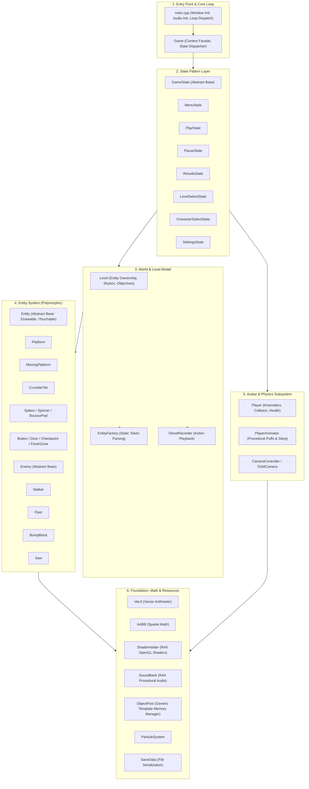
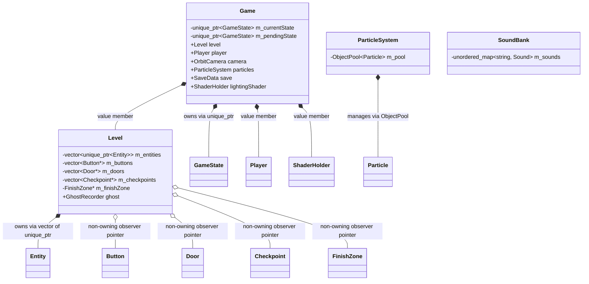

# High-Level Architecture & System Design

**Branch:** `2d-version`  
**Document:** Structural & Architectural Blueprint  
**Namespace:** `obby`

---

## 1. Architectural Overview & Layering

The codebase employs an encapsulated, modular architecture partitioned into distinct behavioral layers:

---

## 2. Source Code Inventory

Every source file in the repository has a dedicated single responsibility:

| Source Header / Implementation | Module / Layer | Exact Responsibilities |
|---|---|---|
| `src/main.cpp` | Core | Program entry point, CLI flag parsing (`--smoke-test`, `--validate`), window/audio init, frame loop. |
| `src/game.h` / `game.cpp` | Core Context | Game context facade, active/pending state ownership, save game lifecycle, level index progression. |
| `src/game_state.h` | State Machine | Abstract base class `GameState` defining lifecycle (`enter`, `exit`, `handleInput`, `update`, `draw`). |
| `src/menu_state.h` / `menu_state.cpp` | State Machine | Main title menu: Start, Level Select, Character Select, Settings, Quit buttons. |
| `src/play_state.h` / `play_state.cpp` | State Machine | In-game loop: fixed-timestep physics accumulator, camera updates, HUD rendering, screen shake. |
| `src/pause_state.h` / `pause_state.cpp` | State Machine | Pause overlay modal with Resume, Restart, Settings, and Exit options. |
| `src/results_state.h` / `results_state.cpp` | State Machine | Level completion modal: displays time, par time, stars, Next Level, and Retry buttons. |
| `src/level_select_state.h` / `level_select_state.cpp` | State Machine | Grid UI selecting across 4 unlocked worlds and 20 individual levels. |
| `src/character_select_state.h` / `character_select_state.cpp` | State Machine | Shirt customization menu choosing across 6 preset color palettes. |
| `src/settings_state.h` / `settings_state.cpp` | State Machine | Volume slider, camera sensitivity slider, and invert-Y axis toggle. |
| `src/player.h` / `player.cpp` | Player Avatar | Player kinematics, jumping, coyote/buffer timers, AABB collision resolution, hearts, and coins. |
| `src/player_animator.h` / `player_animator.cpp` | Player Avatar | Procedural limb swinging, jump arm poses, landing squashes, and drop shadow projection. |
| `src/camera.h` / `camera.cpp` | Camera | Legacy compatibility wrapper for the third-person camera. |
| `src/camera_controller.h` / `camera_controller.cpp` | Camera | Third-person spherical orbit camera with yaw/pitch clamping, zoom, and geometric occlusion pull-in. |
| `src/entity.h` / `entity.cpp` | Entity Model | Abstract base class `Entity` implementing interfaces `IDrawable` and `ITouchable`. |
| `src/drawable.h` | Entity Model | Pure virtual interface `IDrawable` (`draw() const = 0`). |
| `src/touchable.h` | Entity Model | Pure virtual interface `ITouchable` (`onPlayerTouch(Player&) = 0`). |
| `src/entity_factory.h` / `entity_factory.cpp` | Entity Model | Static factory parsing string tokens from level files into concrete `std::unique_ptr<Entity>`. |
| `src/platform.h` / `platform.cpp` | Entity Model | Static solid block platform with position-hash color variation and top cap borders. |
| `src/moving_platform.h` / `moving_platform.cpp` | Entity Model | Multi-level derived platform moving along sinusoidal trajectories and transporting grounded players. |
| `src/crumble_tile.h` / `crumble_tile.cpp` | Entity Model | Platform that shakes and falls when stepped upon, respawning after a delay. |
| `src/spikes.h` / `spikes.cpp` | Entity Model | Instant-kill static hazard pad with metallic pyramid spikes. |
| `src/spinner.h` / `spinner.cpp` | Entity Model | Rotating lethal obstacle bar revolving around a central pivot. |
| `src/bounce_pad.h` / `bounce_pad.cpp` | Entity Model | Elastic spring pad launching players upward at high velocity. |
| `src/checkpoint.h` / `checkpoint.cpp` | Entity Model | Waypoint pad with animated waving flag that saves player respawn coordinates and fully heals hearts. |
| `src/finish_zone.h` / `finish_zone.cpp` | Entity Model | Goal zone triggering level completion and confetti bursts upon entry. |
| `src/button.h` / `button.cpp` | Entity Model | Timed pressure plate triggered by player or ghost clone to open linked doors. |
| `src/door.h` / `door.cpp` | Entity Model | Barrier that lowers/retracts into the floor when its linked button is active. |
| `src/enemy.h` / `enemy.cpp` | Entity Model | Abstract base class `Enemy` managing direction, alive state, flatten timers, and stomp detection. |
| `src/walker.h` / `walker.cpp` | Entity Model | Ground-patrolling enemy pacing at 2.0 m/s with autonomous wall and ledge detection. |
| `src/flyer.h` / `flyer.cpp` | Entity Model | Aerial enemy oscillating along sinusoidal vertical curves unaffected by gravity. |
| `src/bump_block.h` / `bump_block.cpp` | Entity Model | Question block that bounces when hit from below, releasing coins and turning empty gray. |
| `src/saw.h` / `saw.cpp` | Entity Model | Continuously rotating circular saw blade translating linearly between two track endpoints. |
| `src/level.h` / `level.cpp` | World Model | Level manager owning entities, skybox rendering, kill plane checks, and par times. |
| `src/ghost_recorder.h` / `ghost_recorder.cpp` | World Model | Records player motion frames and replays them via an interactive translucent clone. |
| `src/level_error.h` | World Model | Custom exception `LevelParseError` carrying line numbers and error diagnostics. |
| `src/validator.h` / `validator.cpp` | World Model | BFS reachability validator verifying maximum jump gaps, saw path clearances, and bump block accessibility. |
| `src/vec3.h` / `vec3.cpp` | Math & Spatial | 3D mathematical vector with overloaded arithmetic and relational operators. |
| `src/aabb.h` / `aabb.cpp` | Math & Spatial | Axis-Aligned Bounding Box value class providing intersection, containment, and sweep routines. |
| `src/collision.h` / `collision.cpp` | Math & Spatial | Geometric intersection routines connecting custom spatial classes with raylib types. |
| `src/constants.h` | Foundation | Central compile-time configuration defining all kinodynamic, visual, and timing metrics. |
| `src/render_utils.h` / `render_utils.cpp` | Graphics | Color manipulation, deterministic position hashing, world palette lookups, and visual styling. |
| `src/shader_holder.h` / `shader_holder.cpp` | Graphics | RAII resource wrapper managing loading, uniform binding, and unloading of OpenGL shaders. |
| `src/sound_bank.h` / `sound_bank.cpp` | Audio | RAII resource bank synthesizing procedural audio waveforms and managing audio device lifetime. |
| `src/audio.h` / `audio.cpp` | Audio | Global facade providing clean static audio playback calls. |
| `src/object_pool.h` | Memory | Reusable template class implementing an $O(1)$ swap-and-pop object pool for heap-free allocations. |
| `src/particle.h` / `particle.cpp` | Graphics | High-speed particle emitter managing confetti, dust puffs, and checkpoint bursts. |
| `src/ui.h` / `ui.cpp` | UI | Immediate-mode UI widgets: buttons, sliders, toggles, HUD, and results cards. |
| `src/saveable.h` | Persistence | Pure virtual interface `ISaveable` declaring `load()` and `save()`. |

---

## 3. Ownership and Lifetime Semantics

The architecture uses strict **single-ownership** and **RAII** patterns without raw owning pointers:

### Detailed Ownership Rules
1. **`Game` owns the active `GameState`:** Held exclusively via `std::unique_ptr<GameState>`. When transitioning states, the old state is exited and destroyed before the new state is entered.
2. **`Level` owns all `Entity` instances:** Held polymorphically in `std::vector<std::unique_ptr<Entity>>`. Observer lists (`m_buttons`, `m_doors`, `m_checkpoints`) store non-owning raw pointers (`Button*`, `Door*`) for fast cross-entity query dispatch without interfering with ownership.
3. **Deferred Removal (`std::remove_if`):** Defeated enemies are destroyed safely at the end of `Level::Update()` by evaluating `e->isExpired()`.
4. **Shader and Audio Device Handles:** Managed by `ShaderHolder` and `SoundBank` via RAII. The destructors invoke `UnloadShader()`, `UnloadSound()`, and `CloseAudioDevice()` automatically upon application shutdown.
