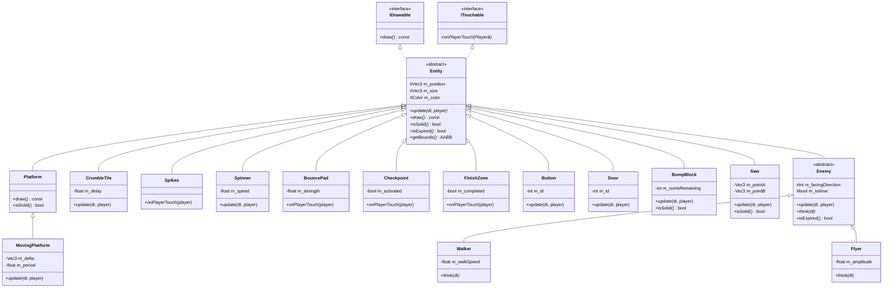
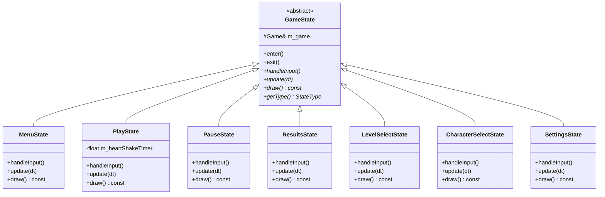

# Class-by-Class Technical Reference

**Branch:** `2d-version`  
**Document:** Low-Level Object-Oriented Class Reference  
**Namespace:** `obby`

---

## 1. Spatial, Math & Geometry Value Classes

### 1.1 `Vec3`
- **Header / Source:** `src/vec3.h` / `src/vec3.cpp`
- **Purpose:** 3D floating-point vector value class with algebraic operator overloading.
- **Base Class:** None.
- **Key Members:**
  - `float x, y, z`: Coordinate components (public value struct semantics).
- **Key Methods:**
  - `length() const -> float`: Computes Euclidean magnitude $\sqrt{x^2+y^2+z^2}$.
  - `normalized() const -> Vec3`: Returns unit-length direction vector.
  - `dot(const Vec3&) const -> float`: Computes scalar dot product.
  - `toRaylib() const -> Vector3`: Conversion helper to raylib's C struct.
  - `operator+`, `operator-`, `operator*`, `operator+=`, `operator-=` `operator==`: Overloaded vector arithmetic operators.

### 1.2 `AABB`
- **Header / Source:** `src/aabb.h` / `src/aabb.cpp`
- **Purpose:** Axis-Aligned Bounding Box value class used for all collision detection.
- **Base Class:** None.
- **Key Members:**
  - `Vec3 m_min, m_max`: Enclosing spatial bounds (private, encapsulated).
- **Key Methods:**
  - `fromCenterSize(center, size) -> AABB`: Factory constructing AABB from center and extents.
  - `intersects(const AABB&) const -> bool`: Evaluates boolean overlap with another AABB.
  - `contains(const Vec3&) const -> bool`: Tests if a point lies within the box.
  - `getCenter() const -> Vec3`, `getSize() const -> Vec3`: Spatial metric accessors.
  - `operator==`, `operator!=`: Value equality comparison operators.

---

## 2. Entity Hierarchy

### 2.1 `IDrawable` (Interface)
- **Header:** `src/drawable.h`
- **Purpose:** Behavioral contract for renderable objects.
- **Virtual Methods:** `virtual void draw() const = 0`, `virtual ~IDrawable() = default`.

### 2.2 `ITouchable` (Interface)
- **Header:** `src/touchable.h`
- **Purpose:** Behavioral contract for player collision reaction.
- **Virtual Methods:** `virtual void onPlayerTouch(Player&) = 0`, `virtual ~ITouchable() = default`.

### 2.3 `Entity` (Abstract Base)
- **Header / Source:** `src/entity.h` / `src/entity.cpp`
- **Purpose:** Base class for all interactive world objects, unifying drawing, collision, and lifecycle.
- **Base Class:** `public IDrawable`, `public ITouchable` (Multiple Interface Inheritance).
- **Key Members:**
  - `Vec3 m_position, m_size`: Spatial center and dimensions (protected).
  - `Color m_color`: Base tint (protected).
  - `static int s_entityCount`: Live entity instance counter (protected static).
- **Key Methods:**
  - `virtual void update(float dt, Player& player) = 0`: Pure virtual per-tick logic.
  - `virtual void draw() const = 0`: Pure virtual rendering.
  - `virtual bool isSolid() const`: Returns `true` by default; overridden by non-solid entities.
  - `virtual bool isExpired() const`: Returns `false` by default; overridden by defeated enemies for deferred removal.
  - `virtual AABB getBounds() const`: Returns `AABB::fromCenterSize(m_position, m_size)`.
  - `static int getEntityCount()`: Active instance query.

### 2.4 `Platform`
- **Header / Source:** `src/platform.h` / `src/platform.cpp`
- **Purpose:** Solid static platform with procedural top caps and deterministic position-hash color variations.
- **Base Class:** `public Entity`.
- **Overrides:** `update()`, `draw()`, `isSolid() -> true`.

### 2.5 `MovingPlatform`
- **Header / Source:** `src/moving_platform.h` / `src/moving_platform.cpp`
- **Purpose:** Oscillating kinematic platform that transports standing players.
- **Base Class:** `public Platform` (Demonstrates Multi-Level Inheritance).
- **Key Members:** `Vec3 m_basePos, m_delta`, `float m_period, m_elapsedTime`, `Vec3 m_frameDisplacement`.
- **Overrides:** `update()` (advances sine position, computes frame delta, moves player), `draw()`.

### 2.6 `CrumbleTile`
- **Header / Source:** `src/crumble_tile.h` / `src/crumble_tile.cpp`
- **Purpose:** Collapsing platform that shakes and drops when touched, then respawns.
- **Base Class:** `public Entity`.
- **Key Members:** `enum State { INTACT, SHAKING, FALLEN }`, `float m_delay, m_respawnTimer`.
- **Overrides:** `update()`, `draw()`, `isSolid()`.

### 2.7 `Spikes`
- **Header / Source:** `src/spikes.h` / `src/spikes.cpp`
- **Purpose:** Lethal ground hazard inflicting instant player death.
- **Base Class:** `public Entity`.
- **Overrides:** `update()`, `draw()`, `onPlayerTouch(player)` (calls `player.respawn()`).

### 2.8 `Spinner`
- **Header / Source:** `src/spinner.h` / `src/spinner.cpp`
- **Purpose:** Rotating hazard arm sweeping across platforms.
- **Base Class:** `public Entity`.
- **Key Members:** `float m_length, m_speed, m_angle`.
- **Overrides:** `update()`, `draw()`, `onPlayerTouch(player)`.

### 2.9 `BouncePad`
- **Header / Source:** `src/bounce_pad.h` / `src/bounce_pad.cpp`
- **Purpose:** Spring launcher boosting player upward at launch velocity.
- **Base Class:** `public Entity`.
- **Key Members:** `float m_strength`.
- **Overrides:** `update()`, `draw()`, `onPlayerTouch(player)`.

### 2.10 `Checkpoint`
- **Header / Source:** `src/checkpoint.h` / `src/checkpoint.cpp`
- **Purpose:** Waypoint pad with waving flag; updates respawn point and fully heals hearts.
- **Base Class:** `public Entity`.
- **Key Members:** `bool m_activated`, `float m_waveTimer`.
- **Overrides:** `update()`, `draw()`, `onPlayerTouch(player)`.

### 2.11 `FinishZone`
- **Header / Source:** `src/finish_zone.h` / `src/finish_zone.cpp`
- **Purpose:** Level completion trigger portal with rotating star.
- **Base Class:** `public Entity`.
- **Key Members:** `bool m_completed`, `float m_rotationAngle`.
- **Overrides:** `update()`, `draw()`, `onPlayerTouch(player)`.

### 2.12 `Button` & `Door`
- **Header / Source:** `src/button.h` / `src/button.cpp`, `src/door.h` / `src/door.cpp`
- **Purpose:** Cooperatively linked puzzle elements (timed pressure button and retracting door).
- **Base Class:** `public Entity`.
- **Key Members:**
  - `Button`: `int m_id`, `float m_duration, m_currentTimer`, `bool m_isPressed, m_isActive, m_ghostTouching`.
  - `Door`: `int m_id`, `bool m_isOpen`, `float m_currentHeight`.
- **Overrides:** `update()`, `draw()`, `onPlayerTouch()`, `isSolid()`.

### 2.13 `Enemy` (Abstract Sub-Base)
- **Header / Source:** `src/enemy.h` / `src/enemy.cpp`
- **Purpose:** Base class for all mobile enemies, handling stomping, flatten timers, and health damage.
- **Base Class:** `public Entity`.
- **Key Members:** `int m_facingDirection`, `bool m_isAlive, m_isFlattened`, `float m_flattenTimer`, `Vec3 m_startPos`.
- **Overrides:** `update()` (calls `think()`, arbitrates stomp vs body contact), `isSolid() -> false`, `isExpired()`, `getBounds()`.
- **New Virtual Methods:** `virtual void think(float dt) = 0`, `virtual void onStomped()`, `virtual void onHitPlayer(Player&)`.

### 2.14 `Walker`
- **Header / Source:** `src/walker.h` / `src/walker.cpp`
- **Purpose:** Ground patrol enemy that detects walls and ledges autonomously.
- **Base Class:** `public Enemy`.
- **Key Members:** `float m_range, m_walkSpeed`, `static const std::vector<AABB>* s_levelColliders`.
- **Overrides:** `think(dt)` (runs wall and ledge ray-probes), `draw()`.

### 2.15 `Flyer`
- **Header / Source:** `src/flyer.h` / `src/flyer.cpp`
- **Purpose:** Aerial enemy moving along sinusoidal flight curves.
- **Base Class:** `public Enemy`.
- **Key Members:** `float m_amplitude, m_waveSpeed, m_flySpeed, m_range, m_elapsedTime`.
- **Overrides:** `think(dt)`, `draw()`.

### 2.16 `BumpBlock`
- **Header / Source:** `src/bump_block.h` / `src/bump_block.cpp`
- **Purpose:** Solid question-mark block that pops coins when hit from underneath.
- **Base Class:** `public Entity`.
- **Key Members:** `int m_coinsRemaining, m_worldId`, `float m_bounceTimer, m_coinPopTimer`.
- **Overrides:** `update()`, `draw()`, `isSolid() -> true`, `getBounds() -> resting AABB`.

### 2.17 `Saw`
- **Header / Source:** `src/saw.h` / `src/saw.cpp`
- **Purpose:** Non-solid rotating hazard blade translating along a track.
- **Base Class:** `public Entity`.
- **Key Members:** `Vec3 m_pointA, m_pointB`, `float m_speed, m_radius, m_rotationAngle, m_progress`.
- **Overrides:** `update()`, `draw()`, `isSolid() -> false`.

---

## 3. Avatar, Camera & Controllers

### 3.1 `Player`
- **Header / Source:** `src/player.h` / `src/player.cpp`
- **Purpose:** Encapsulates avatar physics state, input response, collision substepping, health, and coins.
- **Base Class:** None (Stand-alone encapsulated domain entity).
- **Key Members:**
  - `Vec3 m_position, m_velocity`: Kinematic position and velocity.
  - `bool m_isGrounded, m_wasGrounded`: Contact states.
  - `float m_coyoteTimer, m_jumpBufferTimer`: Jump assist windows.
  - `int m_hearts, m_maxHearts, m_coins`: Health and inventory counters.
  - `float m_invincibleTimer`: Damage immunity countdown.
  - `PlayerAnimator m_animator`: Composition of procedural animator.
- **Key Methods:**
  - `updatePhysics(dt, input, cameraYaw, colliders, particles)`: Runs horizontal accel, gravity, and substepped AABB resolution.
  - `takeDamage(knockDir)`: Inflicts 1 heart loss, invincibility, and knockback.
  - `heal(amount)`: Restores hearts up to `m_maxHearts`.
  - `jump()`: Applies instantaneous vertical jump velocity.

### 3.2 `PlayerAnimator`
- **Header / Source:** `src/player_animator.h` / `src/player_animator.cpp`
- **Purpose:** Procedural animation state machine calculating limb swing angles, landing squashes, and drop shadow projection.

### 3.3 `CameraController` / `OrbitCamera`
- **Header / Source:** `src/camera_controller.h` / `src/camera_controller.cpp`
- **Purpose:** Spherical orbit camera orbiting the player with mouse/keyboard rotation, zoom clamping, and obstacle occlusion pull-in.

---

## 4. World & Level Management

### 4.1 `Level`
- **Header / Source:** `src/level.h` / `src/level.cpp`
- **Purpose:** Level container managing entities, background skybox, objectives, and kill plane checks.
- **Key Members:**
  - `std::vector<std::unique_ptr<Entity>> m_entities`: Polymorphic ownership of entities.
  - Observer lists: `std::vector<Button*> m_buttons`, `std::vector<Door*> m_doors`, `std::vector<Checkpoint*> m_checkpoints`, `FinishZone* m_finishZone`.
  - `GhostRecorder ghost`: Cooperative ghost clone system.

### 4.2 `EntityFactory`
- **Header / Source:** `src/entity_factory.h` / `src/entity_factory.cpp`
- **Purpose:** Static factory parsing tokens from `.lvl` files into concrete `std::unique_ptr<Entity>`.
- **Method:** `static std::unique_ptr<Entity> createEntity(type, ss, worldId)`.

### 4.3 `GhostRecorder`
- **Header / Source:** `src/ghost_recorder.h` / `src/ghost_recorder.cpp`
- **Purpose:** Records player trajectory ticks and replays them via an interactive translucent clone.

### 4.4 `LevelValidator`
- **Header / Source:** `src/validator.h` / `src/validator.cpp`
- **Purpose:** Automated reachability verification tool running BFS path-gap checks and validating 2D hazard placements across all levels.

---

## 5. State Machine Hierarchy

### 5.1 `GameState` (Abstract Base)
- **Header:** `src/game_state.h`
- **Purpose:** Defines the interface for polymorphic game states.
- **Methods:** `enter()`, `exit()`, `handleInput() = 0`, `update(dt) = 0`, `draw() const = 0`, `getType() const = 0`.

### 5.2 Concrete States
- `MenuState` (`src/menu_state.h`): Primary application entry menu.
- `PlayState` (`src/play_state.h`): In-game fixed-step simulation, HUD, and camera loop.
- `PauseState` (`src/pause_state.h`): In-game modal pause overlay.
- `ResultsState` (`src/results_state.h`): Level completion screen with star ratings and par comparison.
- `LevelSelectState` (`src/level_select_state.h`): Level selection grid across worlds.
- `CharacterSelectState` (`src/character_select_state.h`): Avatar shirt color customizer.
- `SettingsState` (`src/settings_state.h`): Audio volume, mouse sensitivity, and invert-Y options.

---

## 6. Mermaid Class Diagrams

### 6.1 Complete Entity Inheritance Hierarchy

### 6.2 GameState Hierarchy

