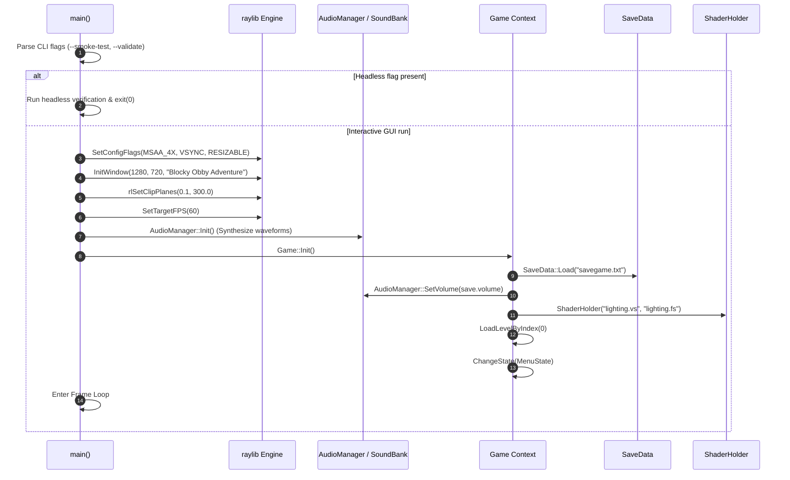
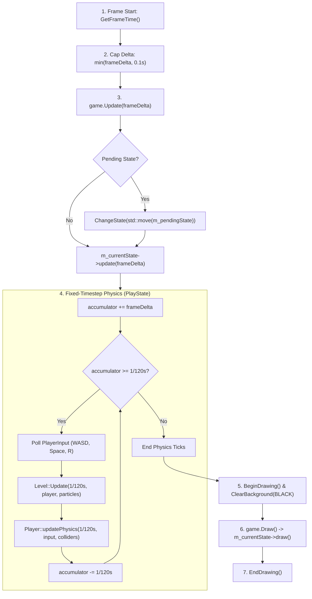
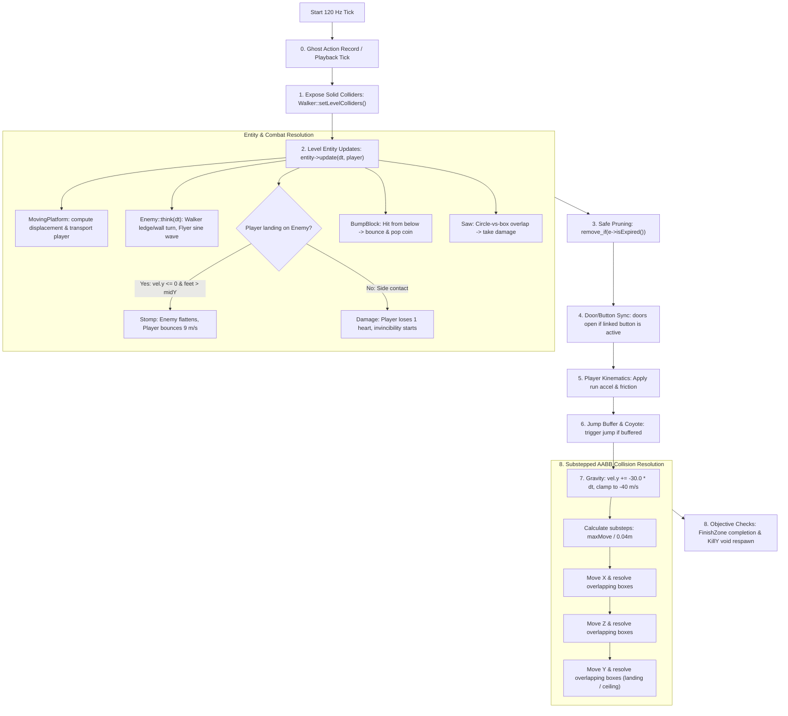
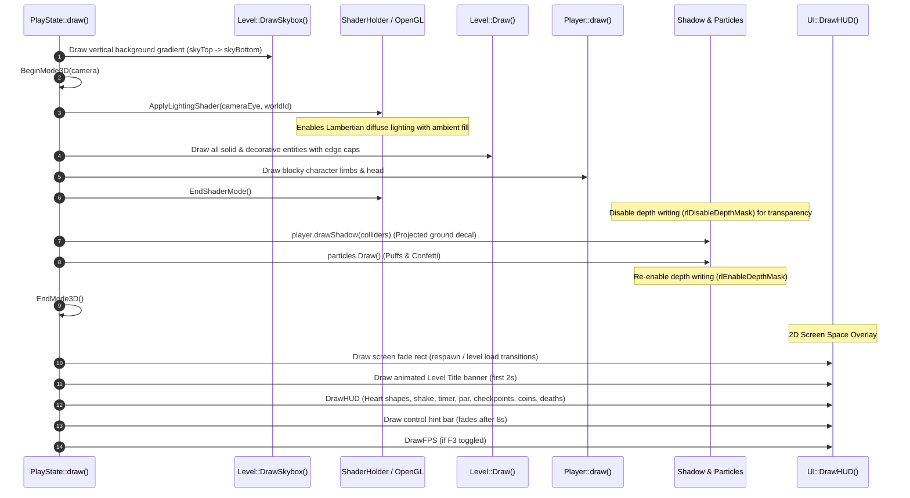
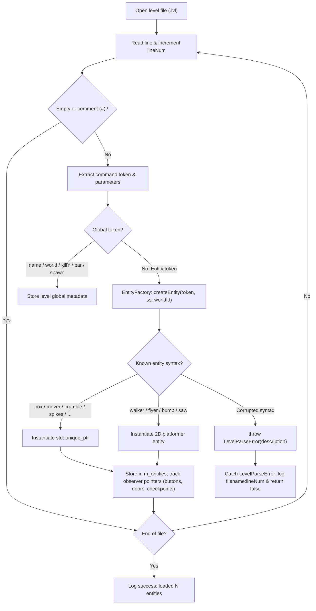
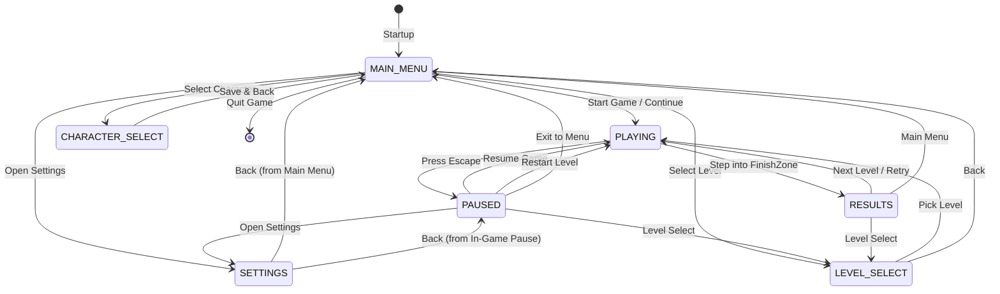
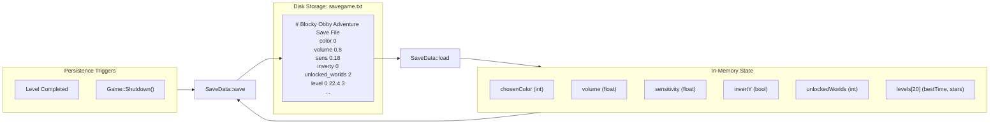
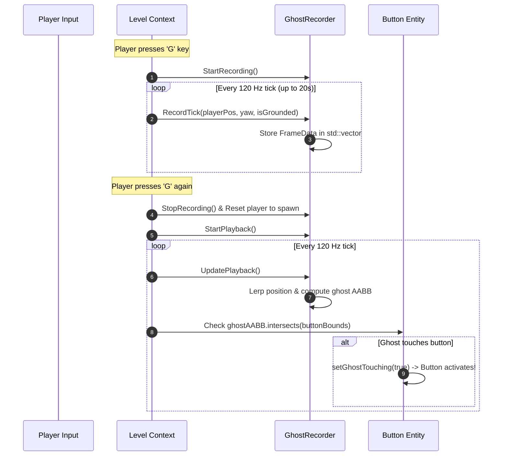

# Data & Control Flow Pipelines

**Branch:** `2d-version`  
**Document:** System Execution & Data Flow Pipelines  

---

## 1. Startup Pipeline

The startup sequence initializes hardware abstractions, loads saved configuration, compiles custom shaders, and transitions into the primary game state:

---

## 2. Main Loop Pipeline

The game loop enforces a strict separation between rendering rate and physics simulation rate using a **fixed-timestep accumulator**:

---

## 3. Update Pipeline (One 120 Hz Physics Step)

Inside each $1/120\text{ s}$ tick, the game updates game entities, moves moving platforms, applies gravity, resolves collisions via substepping, arbitrates enemy combat, and checks level triggers:

---

## 4. Render Pipeline & Layering

The rendering pipeline coordinates 3D geometry, custom lighting shaders, transparent shadow/particle passes, and 2D immediate-mode UI overlays:

---

## 5. Level Loading & Parsing Pipeline

Levels are loaded via a robust parsing pipeline that turns line-based tokens into entity objects with detailed syntax diagnostics:

---

## 6. Game State Transition Graph

State transitions are mediated by the `Game` context using the **State Pattern**:

---

## 7. Save and Persistence Pipeline

Game data is persisted in a simple plain-text key-value format in `savegame.txt`:

---

## 8. Ghost-Clone Recording and Playback Pipeline

The ghost-clone system records player movement frames into an in-memory trajectory array and replays it as an interactive entity:

