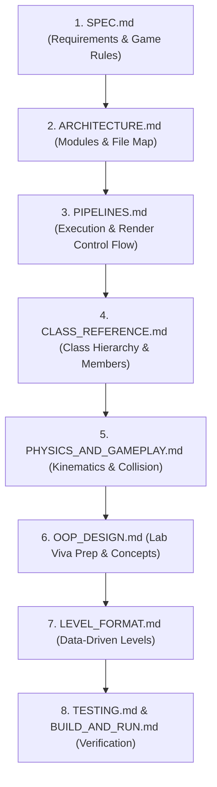

# Blocky Obby Adventure - Technical Documentation Index

**Branch:** `2d-version`  
**Target Codebase:** C++17 / raylib 5.5 single-player 3D/2D platformer ("Blocky Obby Adventure").  
**Build Toolchain:** CMake 3.20+, Clang/GCC with `-Wall -Wextra -pedantic -Werror`.

---

## 1. Documentation Index

The technical documentation for this repository is organized into the following focused guides:

| Document | Description |
|---|---|
| [**SPEC.md**](SPEC.md) | Software specifications, numbered functional/non-functional requirements, controls, game rules, and star rating criteria. |
| [**ARCHITECTURE.md**](ARCHITECTURE.md) | High-level system architecture, module responsibilities, complete file inventory, ownership/lifetime semantics, and Mermaid component diagram. |
| [**PIPELINES.md**](PIPELINES.md) | Step-by-step data and control flow pipelines (startup, 120 Hz fixed-step loop, physics resolution, rendering passes, level parsing, state transitions, save/load, ghost playback) with Mermaid sequence and flow diagrams. |
| [**CLASS_REFERENCE.md**](CLASS_REFERENCE.md) | Comprehensive class-by-class technical reference, access control breakdowns, virtual method overrides, and Mermaid class diagrams for Entity and GameState hierarchies. |
| [**PHYSICS_AND_GAMEPLAY.md**](PHYSICS_AND_GAMEPLAY.md) | Detailed kinodynamics model, all numerical tuning constants, jump mechanics (coyote time, buffer), AABB substepped collision resolution, moving platform transport, hazard/enemy logic, and scoring formulas. |
| [**LEVEL_FORMAT.md**](LEVEL_FORMAT.md) | Complete grammar and specification for `.lvl` plain-text level files, coordinate systems, parsing rules, error handling, and catalog of all 20 campaign levels plus 2D showcase levels. |
| [**OOP_DESIGN.md**](OOP_DESIGN.md) | Academic OOP lab defense guide covering all 14 core OOP concepts with real code snippets, locations, and design rationale for examination/viva defense. |
| [**EXTENDING.md**](EXTENDING.md) | Step-by-step developer tutorials with full worked examples for adding new entities, enemy types, level files, world palettes, and game states. |
| [**BUILD_AND_RUN.md**](BUILD_AND_RUN.md) | Toolchain prerequisites, multi-platform build instructions (macOS, Linux, Windows), CLI execution flags, and troubleshooting steps. |
| [**TESTING.md**](TESTING.md) | Automated headless test suite breakdown (16 verification suites), level reachability validator, expected output benchmarks, and unverified areas. |
| [**KNOWN_ISSUES.md**](KNOWN_ISSUES.md) | Honest disclosure of limitations, audio fallback handling, edge cases, and future engineering roadmap. |
| [**GLOSSARY.md**](GLOSSARY.md) | Definitions and explanations of domain-specific terminology (AABB, fixed timestep, coyote time, RAII, vtable, Lambert shading, etc.). |

---

## 2. Recommended Reading Order

For reviewers, evaluators, and students preparing for a viva defense, the following reading order is recommended:

1. **System Understanding:** Start with [SPEC.md](SPEC.md) to understand the requirements, scope, and game rules, then proceed to [ARCHITECTURE.md](ARCHITECTURE.md) to see how modules are organized and who owns what.
2. **Execution & Data Flow:** Read [PIPELINES.md](PIPELINES.md) to trace the game loop from `main()` down to substepped physics ticks and multi-pass rendering.
3. **OOP & Code Structure:** Study [CLASS_REFERENCE.md](CLASS_REFERENCE.md) and [OOP_DESIGN.md](OOP_DESIGN.md) for class contracts, inheritance trees, and viva defense answers.
4. **Mechanics & Data:** Review [PHYSICS_AND_GAMEPLAY.md](PHYSICS_AND_GAMEPLAY.md) and [LEVEL_FORMAT.md](LEVEL_FORMAT.md) for movement physics and level syntax.
5. **Practical Application & Testing:** Finish with [EXTENDING.md](EXTENDING.md), [BUILD_AND_RUN.md](BUILD_AND_RUN.md), and [TESTING.md](TESTING.md).

---

## 3. Note on Diagram Rendering

All architectural and pipeline diagrams in this documentation suite are written in valid GitHub Flavored Markdown **Mermaid** syntax (`flowchart`, `sequenceDiagram`, `classDiagram`, `stateDiagram-v2`). Because offline rendering tools (`mmdc`) were not present in the local build environment, all diagrams have been verified by careful structural inspection adhering strictly to Mermaid 10.x standards (e.g. quoting labels containing parentheses, brackets, or math operators).
